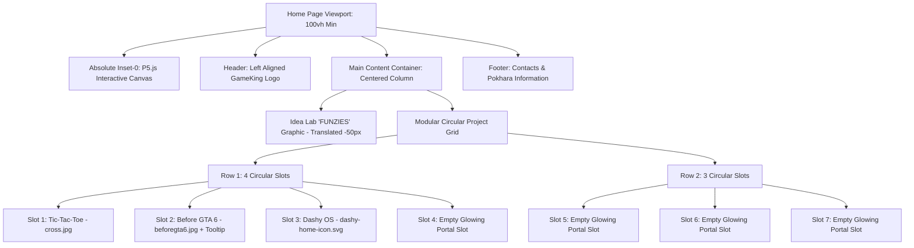
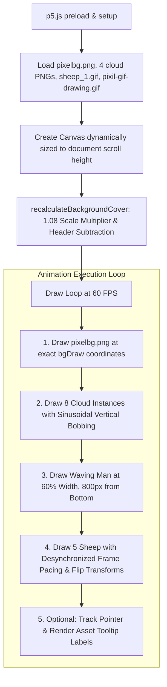
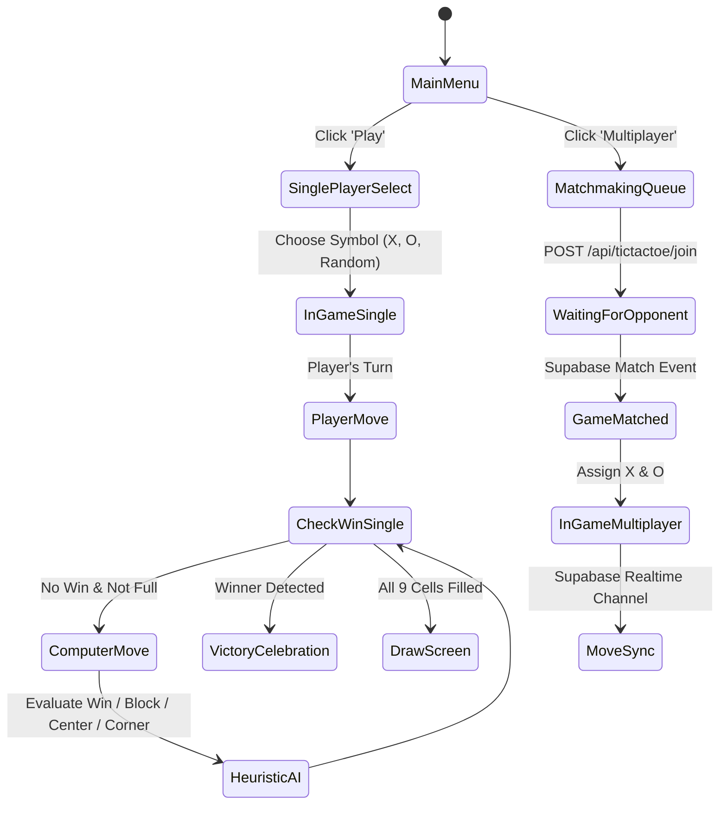
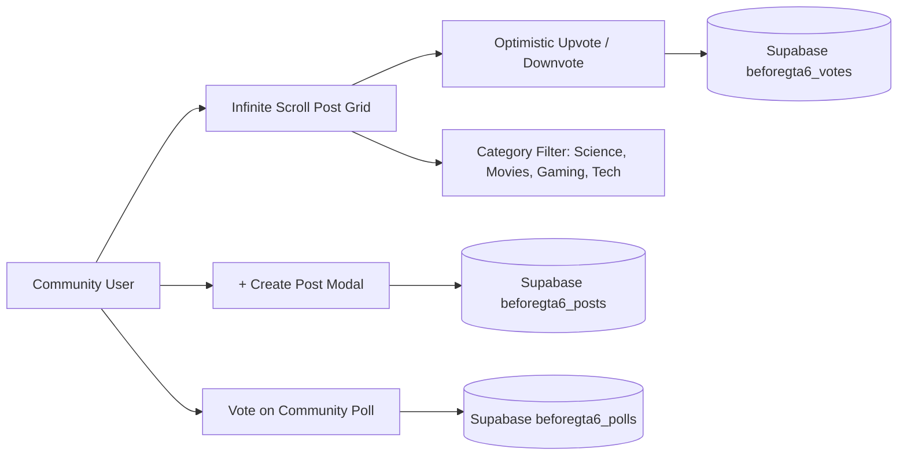
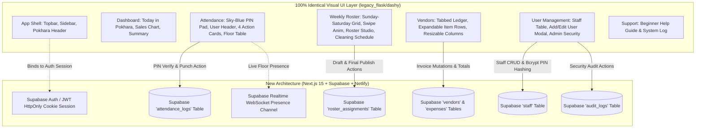
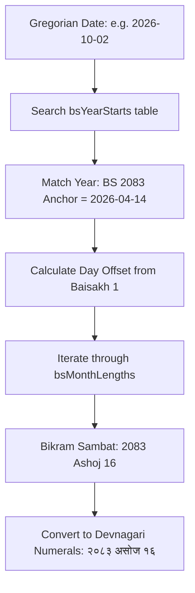
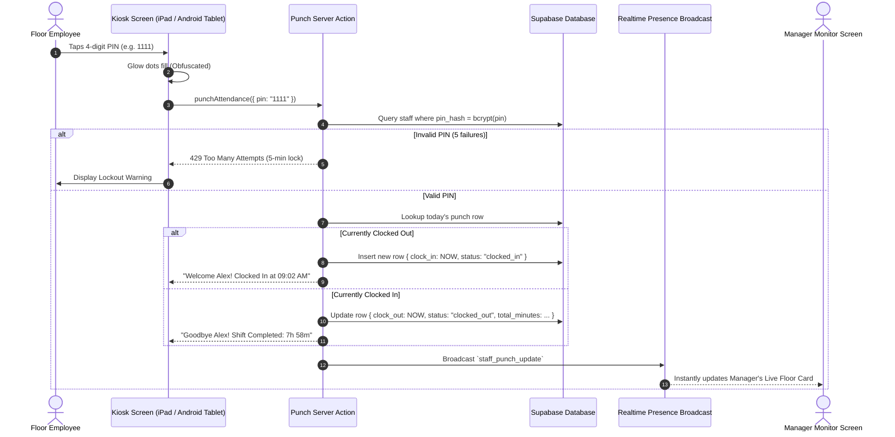
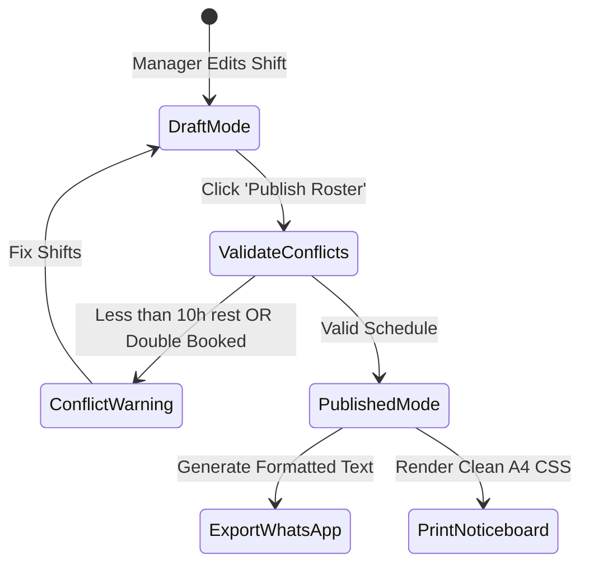

# MASTER SYSTEM DESIGN PROMPT TO LLM: REBUILD GAMEKING & DASHY OS FROM SCRATCH

> **DOCUMENT TYPE**: Master Architecture & Product Specification / Master Prompt for an Autonomous LLM Coding Agent  
> **PROJECT TITLE**: GameKing Entertainment Hub & Dashy by TNH Operating System  
> **AUTHOR / OWNER**: Sushant (GameKing Personal Hobby Project & Commercial Operating System)  
> **LOCATION & TIMEZONE**: Pokhara, Nepal (`Asia/Kathmandu`, UTC+05:45)  
> **DEPLOYMENT TARGET**: **Netlify** (Next.js 15 App Router + React 19 + TypeScript + Tailwind CSS v4)  
> **DATABASE & BACKEND**: **Supabase** (PostgreSQL 16, Supabase Auth, Row Level Security, Supabase Realtime / REST)  
> **LOCAL ASSET DIRECTORY**: `./assets/` (Included directly in this package: all original images, GIFs, SVGs, and scripts)

---

# INSTRUCTION DIRECTIVE FOR THE EXECUTING LLM

```text
========================================================================================
CRITICAL INSTRUCTION DIRECTIVE: READ THIS BEFORE WRITING A SINGLE LINE OF CODE
========================================================================================
You are an Elite Full-Stack Principal Architect and Senior Software Engineer. You have
been provided with this master specification document along with the accompanying `./assets/`
folder containing all images, SVGs, and legacy reference scripts.

YOUR TASK:
Build the complete GameKing Web Platform from absolute scratch inside a new Next.js project.

RULES OF ENGAGEMENT:
1. NO PLACEHOLDERS: Do NOT output "// TODO: Implement later", "// add logic here", or
   simplified mock components. Every page, game, algorithm, database migration, and API
   handler must be completely implemented and production-ready.
2. HOME PAGE FIDELITY: The home page is the user's personal hobby playground. It MUST
   look and feel EXACTLY like the current retro pixel art design (black background #1a1a1a,
   pixelbg.png, P5.js grazing sheep animation, GameKing logo, IDEA LAB logo, and the glowing
   circular project slots).
3. MODULAR PROJECT SLOTS: The circular slots on the home page must be driven by an
   extensible TypeScript configuration array so the user can easily plug in future hobby
   projects without redesigning the layout.
4. FULL GAME LOGIC: The Tic-Tac-Toe game and "Before GTA 6" community hub must NOT be
   static dummy shells. They must be fully functional Next.js pages backed by Supabase tables.
5. FULL DASHY OS: Dashy by TNH is the commercial operating system of the lounge. It must
   feature the full Bikram Sambat (BS) Nepali calendar engine, touchscreen kiosk PIN terminal,
   shift qualification math, weekly roster planner with WhatsApp export, and vendor ledger.
6. TARGET ENVIRONMENT: Configured specifically for deployment on Netlify with Supabase.
========================================================================================
```

---

# TABLE OF CONTENTS
1. [Chapter 1: Project Identity, Vision & System Topology](#chapter-1-project-identity-vision--system-topology)
2. [Chapter 2: Master Visual Design System & Aesthetic Language](#chapter-2-master-visual-design-system--aesthetic-language)
3. [Chapter 3: Home Page Architecture (Exact 1:1 Pixel-Art Hub)](#chapter-3-home-page-architecture-exact-11-pixel-art-hub)
4. [Chapter 4: P5.js Background Animation Engine (Sheep & Clouds)](#chapter-4-p5js-background-animation-engine-sheep--clouds)
5. [Chapter 5: Tic-Tac-Toe Arcade Engine (Minimax AI & Matchmaking)](#chapter-5-tic-tac-toe-arcade-engine-minimax-ai--matchmaking)
6. [Chapter 6: "Before GTA 6" Community Hub & Meme Platform](#chapter-6-before-gta-6-community-hub--meme-platform)
7. [Chapter 7: Dashy OS — Global App Shell & Realtime Header](#chapter-7-dashy-os--global-app-shell--realtime-header)
8. [Chapter 8: Dashy OS — Touchscreen Kiosk & Attendance System](#chapter-8-dashy-os--touchscreen-kiosk--attendance-system)
9. [Chapter 9: Dashy OS — Bikram Sambat (BS) Nepali Calendar Engine](#chapter-9-dashy-os--bikram-sambat-bs-nepali-calendar-engine)
10. [Chapter 10: Dashy OS — Smart Shift Roster & WhatsApp Exporter](#chapter-10-dashy-os--smart-shift-roster--whatsapp-exporter)
11. [Chapter 11: Dashy OS — Vendor Directory & Expense Ledger](#chapter-11-dashy-os--vendor-directory--expense-ledger)
12. [Chapter 12: Dashy OS — Facility Hygiene & Asset Maintenance](#chapter-12-dashy-os--facility-hygiene--asset-maintenance)
13. [Chapter 13: Enterprise Security, Dual Auth & Immutable Audit Ledger](#chapter-13-enterprise-security-dual-auth--immutable-audit-ledger)
14. [Chapter 14: Complete Supabase Database Architecture (DDL & RLS)](#chapter-14-complete-supabase-database-architecture-ddl--rls)
15. [Chapter 15: Netlify Deployment Configuration & Environment Manifest](#chapter-15-netlify-deployment-configuration--environment-manifest)
16. [Chapter 16: Target Project Directory Structure](#chapter-16-target-project-directory-structure)
17. [Chapter 17: Step-by-Step Implementation & Verification Roadmap](#chapter-17-step-by-step-implementation--verification-roadmap)

---

# CHAPTER 1: PROJECT IDENTITY, VISION & SYSTEM TOPOLOGY

## 1.1 The Dual Nature of GameKing
**GameKing** was created by Sushant as both a creative personal programming hobby lab and a practical operational tool for a commercial gaming hub located in Pokhara, Nepal.

The web platform serves two distinct functional missions:
1. **The Public Customer Portal (`/`)**: A playful, nostalgic, retro-pixel-art gateway showcasing the user's creative web experiments ("FUNZIES" / Idea Lab). The centerpiece is an interactive grid of glowing circular portal slots where new hobby mini-games, web tools, or experimental apps can be introduced effortlessly.
2. **Dashy by TNH (`/dashy`)**: A commercial-grade, multi-tenant-ready business operating system managing the day-to-day operations of the gaming lounge: staff timeclock, Bikram Sambat dual calendar scheduling, weekly roster generation, vendor invoices, hygiene checklists, and administrative audit logging.

```mermaid
flowchart TD
    subgraph Ingress ["Netlify Edge CDN Ingress"]
        DNS[User Request] --> EdgeRouter{Path Router}
    end

    subgraph Public_Domain ["Public Creative Hub (Hobby & Experiments)"]
        EdgeRouter -->|Path: / | Home[Retro Pixel Art Landing Page]
        EdgeRouter -->|Path: /tictactoe | TTT[Tic-Tac-Toe Arcade with Minimax AI]
        EdgeRouter -->|Path: /beforegta6 | GTA[Before GTA 6 Community Meme Forum]
        EdgeRouter -->|Path: /slot-n | FutureSlots[Future Experimental Hobby Projects]
    end

    subgraph Backoffice_Domain ["Dashy by TNH: Commercial Business OS"]
        EdgeRouter -->|Path: /dashy | DashyShell[Dashy Global App Shell]
        DashyShell --> Attendance[Touchscreen PIN Kiosk & Shift Attendance]
        DashyShell --> Calendar[Bikram Sambat BS / Gregorian Dual Calendar]
        DashyShell --> Roster[Weekly Shift Roster & WhatsApp Generator]
        DashyShell --> Vendors[Vendor Directory & Accounts Payable Ledger]
        DashyShell --> Cleaning[Station Hygiene & Hardware Maintenance Tickets]
        DashyShell --> Security[RBAC, Salted PINs & Immutable Audit Logs]
    end

    subgraph Backend_Services ["Supabase Cloud Infrastructure"]
        Postgres[(PostgreSQL 16 Database)]
        SupabaseAuth[Supabase Auth Engine]
        Storage[Supabase Object Storage (Receipts & Memes)]
        RealtimeChannel[Supabase Realtime WebSocket Channels]
    end

    Public_Domain -.->|Read/Write Posts & Scores| Postgres
    Backoffice_Domain -->|REST & Server Actions| Postgres
    Backoffice_Domain -->|Session Validation| SupabaseAuth
    Backoffice_Domain -->|Live Floor Presence| RealtimeChannel
    Vendors -->|Invoice Uploads| Storage
    GTA -->|Meme Uploads| Storage
```

---

# CHAPTER 2: MASTER VISUAL DESIGN SYSTEM & AESTHETIC LANGUAGE

The platform employs two visual languages carefully chosen for their specific psychological contexts.

## 2.1 Aesthetic Language A: Retro Pixel Arcade (Public Portal)
- **Mood**: 90s nostalgia, 16-bit arcade cabinet, indie gaming playground.
- **Base Canvas**: Solid `#1a1a1a` overlaid with `./assets/images/pixelbg.png` (`background-position: center center; background-size: cover; background-repeat: no-repeat`).
- **Color Palette Tokens**:
  - `Arcade Black`: `#1a1a1a`
  - `Arcade Neon Gold`: `#ffcc00` (Used for portal circular borders, title drop-shadows, and active button rings)
  - `Arcade Gold Glow`: `rgba(255, 255, 0, 0.30)` (Used for `box-shadow: 0 0 15px rgba(255,255,0,0.3)`)
  - `Retro Cream Yellow`: `#fffdf0` to `#fff7cf` (Tooltip gradient for the "work in progress" bubble)
  - `Charcoal Grey`: `#2a2a2a` (Footer panel background with 50% opacity, tooltip text)
  - `Border Grey`: `#555555` (Footer border line)
  - `Text Light`: `#e0e0e0` / `#ffffff`
- **Portal Circle Button Specifications**:
  - Size: Exactly `150px` width by `150px` height.
  - Border: Exactly `3px solid #ffcc00`.
  - Border Radius: Full circle `rounded-full` (`50%`).
  - Drop Shadow: `0 0 15px rgba(255, 255, 0, 0.3)`.
  - Hover Interaction: Transition `transform 200ms ease`, scale `1.10` (`hover:scale-110`).
  - Active Press: Scale `1.05`.

## 2.2 Aesthetic Language B: Midnight Slate & Emerald (Dashy OS)
- **Mood**: High-efficiency, low eye-strain, professional enterprise operations.
- **Color Palette Tokens**:
  - `Dashy Midnight Navy`: `#0b1320` (Application root background)
  - `Dashy Slate Card`: `#111c2e` (Sidebar panels, table containers, modal bodies)
  - `Dashy Slate Hover`: `#18263e` (Interactive list items, table row hover)
  - `Dashy Border`: `#1e293b` (Subtle boundary borders)
  - `Pokhara Emerald (Primary)`: `#10b981` (Clock in button, success indicators, save actions)
  - `Ocean Blue (Accent)`: `#3b82f6` (Roster links, filter indicators)
  - `Warning Amber`: `#f59e0b` (Unqualified shifts, pending invoices)
  - `Alert Rose`: `#ef4444` (Absent staff, overdue bills, delete actions)

---

# CHAPTER 3: HOME PAGE ARCHITECTURE (EXACT 1:1 PIXEL-ART HUB)



## 3.1 Modular TypeScript Configuration Schema (`src/config/projects.ts`)
To make adding new hobby projects as simple as adding an object, implement this configuration pattern:

```typescript
export interface ProjectCircleSlot {
  id: string;
  title: string;
  href?: string;
  imageSrc?: string;
  imageAlt?: string;
  tooltipText?: string;
  isExternal?: boolean;
  isEmpty?: boolean;
}

export const CIRCLE_PROJECTS_ROW_1: ProjectCircleSlot[] = [
  {
    id: "tictactoe",
    title: "Tic-Tac-Toe Arcade",
    href: "/tictactoe",
    imageSrc: "/images/cross.jpg",
    imageAlt: "Tic-Tac-Toe Arcade Game",
    isEmpty: false,
  },
  {
    id: "beforegta6",
    title: "Before GTA 6",
    href: "/beforegta6",
    imageSrc: "/images/beforegta6.jpg",
    imageAlt: "Before GTA 6 Community Hub",
    tooltipText: "work in progress",
    isEmpty: false,
  },
  {
    id: "dashy",
    title: "Dashy by TNH",
    href: "/dashy",
    imageSrc: "/images/dashy-home-icon.svg",
    imageAlt: "Dashy Internal Business Dashboard",
    isEmpty: false,
  },
  {
    id: "empty-1",
    title: "Future Idea Slot 1",
    isEmpty: true,
  },
];

export const CIRCLE_PROJECTS_ROW_2: ProjectCircleSlot[] = [
  {
    id: "empty-2",
    title: "Future Idea Slot 2",
    isEmpty: true,
  },
  {
    id: "empty-3",
    title: "Future Idea Slot 3",
    isEmpty: true,
  },
  {
    id: "empty-4",
    title: "Future Idea Slot 4",
    isEmpty: true,
  },
];
```

## 3.2 Exact Home Page Implementation (`src/app/page.tsx`)
```tsx
"use client";

import Image from "next/image";
import Link from "next/link";
import Script from "next/script";
import { useEffect, useState } from "react";
import { CIRCLE_PROJECTS_ROW_1, CIRCLE_PROJECTS_ROW_2, ProjectCircleSlot } from "@/config/projects";

export default function HomePage() {
  const [isMounted, setIsMounted] = useState(false);

  useEffect(() => {
    setIsMounted(true);
  }, []);

  const renderCircle = (slot: ProjectCircleSlot) => {
    if (slot.isEmpty || !slot.href) {
      return (
        <div
          key={slot.id}
          className="w-[150px] h-[150px] bg-transparent border-[3px] border-[#ffcc00] rounded-full shadow-[0_0_15px_rgba(255,255,0,0.3)] box-border transition-transform duration-200 hover:scale-105"
          aria-label={slot.title}
        />
      );
    }

    return (
      <Link key={slot.id} href={slot.href} aria-label={slot.title}>
        <div className="relative group w-[150px] h-[150px] bg-transparent border-[3px] border-[#ffcc00] rounded-full flex justify-center items-center text-gray-200 font-bold cursor-pointer shadow-[0_0_15px_rgba(255,255,0,0.3)] transition-transform duration-200 hover:scale-110 overflow-visible box-border">
          {slot.tooltipText && (
            <span className="absolute left-1/2 bottom-[calc(100%+12px)] -translate-x-1/2 translate-y-[6px] bg-gradient-to-b from-[#fffdf0] to-[#fff7cf] text-[#2a2a2a] text-[13px] font-bold tracking-[0.2px] px-[11px] py-[7px] rounded-xl border-2 border-[#ffcc00] shadow-[0_8px_18px_rgba(0,0,0,0.25)] whitespace-nowrap opacity-0 invisible pointer-events-none transition-all duration-200 group-hover:opacity-100 group-hover:visible group-hover:translate-y-0 z-50 after:content-[''] after:absolute after:left-1/2 after:top-full after:-translate-x-1/2 after:w-0 after:h-0 after:border-l-[8px] after:border-l-transparent after:border-r-[8px] after:border-r-transparent after:border-t-[9px] after:border-t-[#fff7cf]">
              {slot.tooltipText}
            </span>
          )}
          {slot.imageSrc && (
            <Image
              src={slot.imageSrc}
              alt={slot.imageAlt || slot.title}
              width={150}
              height={150}
              className={`w-full h-full object-cover rounded-full block mx-auto ${
                slot.id === "dashy" ? "p-4" : ""
              }`}
            />
          )}
        </div>
      </Link>
    );
  };

  return (
    <div
      className="relative flex flex-col min-h-screen text-gray-200 font-sans"
      style={{
        backgroundColor: "#1a1a1a",
        backgroundImage: 'url("/images/pixelbg.png")',
        backgroundPosition: "center center",
        backgroundSize: "cover",
        backgroundAttachment: "scroll",
        backgroundRepeat: "no-repeat",
      }}
    >
      {/* P5.js Background Canvas Container */}
      <div id="backgroundCanvas" className="absolute inset-0 z-0 pointer-events-none" />

      {/* P5 and Background Animation Scripts */}
      {isMounted && (
        <>
          <Script src="https://cdn.jsdelivr.net/npm/p5@1.9.0/lib/p5.js" strategy="afterInteractive" />
          <Script src="/js/background.js?v=sheep-animation-v2" strategy="lazyOnload" />
        </>
      )}

      {/* Top Header with GameKing Logo */}
      <header className="relative z-10 p-5 flex justify-start items-center bg-transparent">
        <Link href="/">
          <Image
            src="/images/gameking_logo_1.png"
            alt="GameKing Logo"
            width={200}
            height={100}
            className="h-auto max-h-[100px] w-auto"
            priority
          />
        </Link>
      </header>

      {/* Main Content Area */}
      <main className="relative z-10 flex-grow p-5 flex flex-col items-center">
        <section className="mt-[50px] text-center w-full">
          {/* IDEA LAB / FUNZIES LOGO */}
          <h2 className="mb-0 inline-block -translate-y-[50px]">
            <Image
              src="/images/idea_lab_logo.png"
              alt="FUNZIES - Idea Lab"
              width={275}
              height={100}
              className="w-[275px] h-auto mx-auto"
              priority
            />
          </h2>

          <div className="flex flex-col items-center gap-5 mt-5 -translate-y-[50px]">
            {/* Row 1: Active Apps + Future Slot */}
            <div className="flex justify-center gap-[30px] flex-wrap">
              {CIRCLE_PROJECTS_ROW_1.map(renderCircle)}
            </div>

            {/* Row 2: Future Expansion Slots */}
            <div className="flex justify-center gap-[30px] flex-wrap">
              {CIRCLE_PROJECTS_ROW_2.map(renderCircle)}
            </div>

            {/* Scrollable Padding for Background Enjoyment */}
            <div className="h-[800px] pointer-events-none" />
          </div>
        </section>
      </main>

      {/* Footer with Contacts */}
      <footer className="relative z-10 bg-[#2a2a2a]/50 p-5 text-center border-t border-[#555] text-[#e0e0e0]">
        <div className="contacts-section">
          <h3 className="mt-0 mb-[10px] text-lg font-bold">Contacts:</h3>
          <p className="my-1">Email: gameking@email.com</p>
          <p className="my-1">Phone: 123-456-7890</p>
          <p className="my-1 text-sm text-gray-400">Lakeside, Pokhara, Nepal</p>
        </div>
      </footer>
    </div>
  );
}
```

---

# CHAPTER 4: P5.JS BACKGROUND ANIMATION ENGINE (SHEEP, WAVING MAN & CLOUDS)

> **CRITICAL REPLICATION DIRECTIVE**:  
> The background animation of GameKing was manually and painstakingly placed, scaled, and calibrated by Sushant. Every cloud altitude, sheep grazing posture, horizontal flip state, waving man ridge coordinate, and background cover aspect ratio calculation is intentional and must be reproduced **EXACTLY as specified**. Do NOT approximate or simplify these values.



---

## 4.1 Master Coordinate, Scale & Animation Specification Tables

### A. Background Canvas & Image Cover Math
- **Base Image**: `/images/pixelbg.png` (or `/static/images/pixelbg.png`).
- **Scale Factor (`BACKGROUND_SCALE`)**: Exactly `1.08` (8% zoom beyond raw canvas cover to prevent white border bleed during responsive resize).
- **Aspect Ratio Logic**:
  $$\text{imgAspect} = \frac{\text{mountainSkyBG.width}}{\text{mountainSkyBG.height}}, \quad \text{canvasAspect} = \frac{\text{sceneWidth}}{\text{sceneHeight}}$$
  - If $\text{canvasAspect} > \text{imgAspect}$: $\text{bgDraw.w} = \text{sceneWidth}$, $\text{bgDraw.h} = \frac{\text{sceneWidth}}{\text{imgAspect}}$, $\text{bgDraw.x} = 0$, $\text{bgDraw.y} = \frac{\text{sceneHeight} - \text{bgDraw.h}}{2}$.
  - Else: $\text{bgDraw.h} = \text{sceneHeight}$, $\text{bgDraw.w} = \text{sceneHeight} \times \text{imgAspect}$, $\text{bgDraw.x} = \frac{\text{sceneWidth} - \text{bgDraw.w}}{2}$, $\text{bgDraw.y} = 0$.
  - **Scale Multiplier & Header Offset**:
    $$\text{bgDraw.w} \times= 1.08, \quad \text{bgDraw.h} \times= 1.08, \quad \text{bgDraw.x} = \frac{\text{sceneWidth} - \text{bgDraw.w}}{2}$$
    $$\text{bgDraw.y} = \text{sceneHeight} - \text{bgDraw.h} - \text{headerHeight}$$
- **Canvas Height**: Dynamically calculated from footer bottom coordinate:
  `sceneHeight = footer ? footer.getBoundingClientRect().bottom + window.scrollY : Math.max(document.documentElement.scrollHeight, windowHeight)`

---

### B. The 8 Himalayan Clouds (Exact Spatial & Motion Vectors)
The clouds are loaded from 4 source PNGs: `cloud_1.png`, `cloud_2.png`, `cloud_3.png`, and `cloud_4.png`.
They are organized into an array: `cloudImgs = [cloud1, cloud2, cloud2, cloud3, cloud3, cloud4, cloud4]`.

Every cloud moves horizontally and bobs vertically according to a harmonic sine wave:
$$y_{\text{render}} = y_{\text{base}} + \sin(\text{frameCount} \times \text{speed} + \text{offset}) \times 10$$
*(Amplitude is strictly $10\text{px}$)*

| Cloud ID | Image Asset | Base X Calculation | Base Y ($y_{\text{base}}$) | Speed Vector | Phase Offset | Visual Scale | Dimensions ($\text{w} \times \text{h}$) |
| :--- | :--- | :--- | :--- | :--- | :--- | :--- | :--- |
| **Cloud 1** | `cloud_1.png` | `sceneWidth * 0.10` | `500px` | `0.020` | `0` | `0.05` | $\text{width} \times 0.05$, $\text{height} \times 0.05$ |
| **Cloud 8** | `cloud_1.png` | `(0.80 + 7 / sceneWidth) * sceneWidth` | `420px` | `0.020` | `0` | `0.05` | $\text{width} \times 0.05$, $\text{height} \times 0.05$ |
| **Cloud 2** | `cloud_2.png` | `sceneWidth * 0.36` | `300px` | `0.015` | `50` | `0.05` | $\text{width} \times 0.05$, $\text{height} \times 0.05$ |
| **Cloud 3** | `cloud_3.png` | `sceneWidth * 0.05` | `260px` | `0.025` | `100` | `0.05` | $\text{width} \times 0.05$, $\text{height} \times 0.05$ |
| **Cloud 4** | `cloud_4.png` | `sceneWidth * 0.70` | `250px` | `0.018` | `150` | `0.05` | $\text{width} \times 0.05$, $\text{height} \times 0.05$ |
| **Cloud 5** | `cloud_4.png` | `sceneWidth * 0.58` | `420px` | `0.022` | `200` | `0.05` | $\text{width} \times 0.05$, $\text{height} \times 0.05$ |
| **Cloud 6** | `cloud_4.png` | `(0.20 - 10 / sceneWidth) * sceneWidth` | `85px` | `0.020` | `250` | `0.05` | $\text{width} \times 0.05$, $\text{height} \times 0.05$ |
| **Cloud 7** | `cloud_4.png` | `(0.70 - 10 / sceneWidth) * sceneWidth` | `80px` | `0.017` | `300` | `0.05` | $\text{width} \times 0.05$, $\text{height} \times 0.05$ |

**Cloud Horizontal Wrap**: When $c.x > \text{sceneWidth} + c.w$, wrap immediately to the far left: $c.x = -c.w$.

---

### C. The Waving Man (`Man1`)
- **Asset**: `/images/pixil-gif-drawing.gif` (or `/static/images/pixil-gif-drawing.gif`).
- **Placement Concept**: A solitary pixel-art figure standing atop a mountain ridge, waving out toward the visitor.
- **X Position**: Exactly `sceneWidth * 0.60` (60% from the left edge of the viewport).
- **Y Position**: Exactly `sceneHeight - 800` (800 pixels above the absolute bottom of the scrollable canvas).
- **Visual Scale**: Exactly `0.22` (Scale factor applied to both width and height: $w = \text{width} \times 0.22$, $h = \text{height} \times 0.22$).
- **Animation**: Animated GIF frame loop rendered directly via `image(Man1.img, Man1.x, Man1.y, Man1.w, Man1.h)`.

---

### D. The 5 Grazing Sheep (`sheep1` Array)
- **Asset**: `/images/sheep_1.gif` (or `/static/images/sheep_1.gif`).
- **Frame Rate Pacing (`SHEEP_FRAME_INTERVAL`)**: Exactly `120` frames.  
  At 60 FPS, the chewing animation advances only once every $2$ seconds ($\frac{120}{60} = 2.0\text{s}$ per animation step, producing a realistic, peaceful 0.5 FPS grazing effect).
- **Animation Desynchronization**: On setup, each sheep is assigned a randomized starting frame offset:  
  `s.animationOffset = floor(random(s.img.numFrames()))`. This prevents all 5 sheep from chewing in robotic synchrony.
- **Chewing Frame Calculation in `draw()`**:  
  `const animationFrame = floor(frameCount / SHEEP_FRAME_INTERVAL);`  
  `s.img.setFrame((animationFrame + s.animationOffset) % s.img.numFrames());`

| Sheep ID | Name | X Coordinate | Y Coordinate | Scale | Horizontal Flip (`flipX`) | Visual Role & Perspective |
| :--- | :--- | :--- | :--- | :--- | :--- | :--- |
| **Sheep 1** | "Sheep 1" | `sceneWidth * 0.80` | `sceneHeight - 500` | `0.370` | `false` (Faces Left) | Mid-foreground pasture on right |
| **Sheep 2** | "Sheep 2" | `sceneWidth * 0.35` | `sceneHeight - 470` | `0.400` | `false` (Faces Left) | Primary foreground sheep on center-left |
| **Sheep 3** | "Sheep 3" | `sceneWidth * 0.90` | `sceneHeight - 800` | `0.200` | `false` (Faces Left) | Distant ridge sheep in far background (small scale) |
| **Sheep 4** | "Sheep 4" | `sceneWidth * 0.08` | `sceneHeight - 390` | `0.400` | **`true` (Faces Right)** | Foreground sheep on far left, turned toward center |
| **Sheep 5** | "Sheep 5" | `sceneWidth * 0.30` | `sceneHeight - 600` | `0.280` | **`true` (Faces Right)** | Mid-ground hillside sheep, turned toward center |

#### Exact Transform Matrix for Horizontally Flipped Sheep:
To flip sheep 4 and 5 horizontally around their individual centers without displacing their global coordinates:
```javascript
s.cx = s.x + s.w / 2;
s.cy = s.y + s.h / 2;

if (s.flipX) {
  push();
  translate(s.cx, s.cy);
  scale(-1, 1); // Flip horizontally on X axis
  translate(-s.cx, -s.cy);
  image(s.img, s.x, s.y, s.w, s.h);
  pop();
} else {
  image(s.img, s.x, s.y, s.w, s.h);
}
```

---

## 4.2 Complete, Verbatim Reference Implementation (`public/js/background.js`)

Here is the exact, complete, unshortened source code that must be loaded by the home page:

```javascript
/* ==========================================================================
   GameKing Himalayan Background Animation Engine
   Author: Sushant (GameKing)
   Components: Drifting Clouds (8 layers), Grazing Sheep (5 instances),
               Waving Ridge Man, Aspect-Covered Himalayan Pixel Canvas.
   ========================================================================== */

let mountainSkyBG;
let cloudImgs = [];
let clouds = [];
let Man1;
let sheep1 = [];
let sceneWidth = 0;
let sceneHeight = 0;
let bgDraw = { w: 0, h: 0, x: 0, y: 0 };
let resizeTimer = null;
const SHEEP_FRAME_INTERVAL = 120; // 0.5 FPS chewing animation rate
const BACKGROUND_SCALE = 1.08;     // 8% zoom beyond raw canvas cover
let pointerPosition = { x: -1, y: -1 };

function getCanvasHeight() {
  const footer = document.querySelector("footer");
  if (footer) {
    return footer.getBoundingClientRect().bottom + window.scrollY;
  }
  return Math.max(document.documentElement.scrollHeight, windowHeight);
}

function recalculateBackgroundCover() {
  if (!mountainSkyBG || !mountainSkyBG.width) return;
  let imgAspect = mountainSkyBG.width / mountainSkyBG.height;
  let canvasAspect = sceneWidth / sceneHeight;

  if (canvasAspect > imgAspect) {
    bgDraw.w = sceneWidth;
    bgDraw.h = sceneWidth / imgAspect;
    bgDraw.x = 0;
    bgDraw.y = (sceneHeight - bgDraw.h) / 2;
  } else {
    bgDraw.h = sceneHeight;
    bgDraw.w = sceneHeight * imgAspect;
    bgDraw.x = (sceneWidth - bgDraw.w) / 2;
    bgDraw.y = 0;
  }

  // Apply scale multiplier
  bgDraw.w *= BACKGROUND_SCALE;
  bgDraw.h *= BACKGROUND_SCALE;
  bgDraw.x = (sceneWidth - bgDraw.w) / 2;
  const headerHeight = document.querySelector("header")?.getBoundingClientRect().height || 0;
  bgDraw.y = sceneHeight - bgDraw.h - headerHeight;
}

function syncSceneSize() {
  const nextHeight = getCanvasHeight();
  if (Math.abs(nextHeight - sceneHeight) < 1) {
    return;
  }
  sceneHeight = nextHeight;
  resizeCanvas(sceneWidth, sceneHeight);
  recalculateBackgroundCover();
}

function preload() {
  // Support both root /images/ and /static/images/ paths
  mountainSkyBG = loadImage(typeof PIXEL_BG_PATH !== "undefined" ? PIXEL_BG_PATH : "/images/pixelbg.png");
  let cloud1 = loadImage("/images/cloud_1.png");
  let cloud2 = loadImage("/images/cloud_2.png");
  let cloud3 = loadImage("/images/cloud_3.png");
  let cloud4 = loadImage("/images/cloud_4.png");
  cloudImgs = [cloud1, cloud2, cloud2, cloud3, cloud3, cloud4, cloud4];
  
  Man1 = loadImage(typeof man_waving !== "undefined" ? man_waving : "/images/pixil-gif-drawing.gif");
  let sheepGif = loadImage(typeof Sheep !== "undefined" ? Sheep : "/images/sheep_1.gif");
  sheep1 = [sheepGif, sheepGif, sheepGif, sheepGif, sheepGif];
}

function setup() {
  document.documentElement.classList.add("animation-ready");
  sceneWidth = document.documentElement.clientWidth;
  sceneHeight = getCanvasHeight();
  let canvas = createCanvas(sceneWidth, sceneHeight);
  canvas.parent("backgroundCanvas");
  window.addEventListener("mousemove", updatePointerPosition, { passive: true });

  // 1. Initialize Clouds with exact manual positions and speeds
  clouds = [
    { img: cloudImgs[0], x: 0.10, y: 500, speed: 0.02, offset: 0, scale: 0.05, name: "Cloud 1" },
    { img: cloudImgs[0], x: 0.80 + 7 / sceneWidth, y: 420, speed: 0.02, offset: 0, scale: 0.05, name: "Cloud 8" },
    { img: cloudImgs[1], x: 0.36, y: 300, speed: 0.015, offset: 50, scale: 0.05, name: "Cloud 2" },
    { img: cloudImgs[2], x: 0.05, y: 260, speed: 0.025, offset: 100, scale: 0.05, name: "Cloud 3" },
    { img: cloudImgs[3], x: 0.70, y: 250, speed: 0.018, offset: 150, scale: 0.05, name: "Cloud 4" },
    { img: cloudImgs[4], x: 0.58, y: 420, speed: 0.022, offset: 200, scale: 0.05, name: "Cloud 5" },
    { img: cloudImgs[5], x: 0.20 - 10 / sceneWidth, y: 85, speed: 0.02, offset: 250, scale: 0.05, name: "Cloud 6" },
    { img: cloudImgs[6], x: 0.70 - 10 / sceneWidth, y: 80, speed: 0.017, offset: 300, scale: 0.05, name: "Cloud 7" },
  ];

  for (let i = 0; i < clouds.length; i++) {
    let c = clouds[i];
    c.x *= sceneWidth;
    c.w = c.img.width * c.scale;
    c.h = c.img.height * c.scale;
  }

  function updatePointerPosition(event) {
    const canvasEl = document.querySelector("#backgroundCanvas canvas");
    if (!canvasEl) return;
    const canvasBounds = canvasEl.getBoundingClientRect();
    pointerPosition = {
      x: event.clientX - canvasBounds.left,
      y: event.clientY - canvasBounds.top,
    };
  }

  // 2. Initialize Waving Man on mountain ridge
  Man1 = { img: Man1, x: sceneWidth * 0.60, y: sceneHeight - 800, offset: 0, scale: 0.22, name: "Man 1" };
  Man1.w = Man1.img.width * Man1.scale;
  Man1.h = Man1.img.height * Man1.scale;

  // 3. Initialize 5 Grazing Sheep with manual positions, scales, and flip states
  sheep1 = [
    { img: sheep1[0], x: sceneWidth * 0.80, y: sceneHeight - 500, scale: 0.370, name: "Sheep 1" },
    { img: sheep1[1], x: sceneWidth * 0.35, y: sceneHeight - 470, scale: 0.400, name: "Sheep 2" },
    { img: sheep1[2], x: sceneWidth * 0.90, y: sceneHeight - 800, scale: 0.200, name: "Sheep 3" },
    { img: sheep1[3], x: sceneWidth * 0.08, y: sceneHeight - 390, scale: 0.400, flipX: true, name: "Sheep 4" },
    { img: sheep1[4], x: sceneWidth * 0.30, y: sceneHeight - 600, scale: 0.280, flipX: true, name: "Sheep 5" },
  ];

  for (let i = 0; i < sheep1.length; i++) {
    let s = sheep1[i];
    s.w = s.img.width * s.scale;
    s.h = s.img.height * s.scale;
    s.cx = s.x + s.w / 2;
    s.cy = s.y + s.h / 2;
    s.animationOffset = floor(random(s.img.numFrames()));
  }

  recalculateBackgroundCover();
  setTimeout(syncSceneSize, 0);
}

function draw() {
  // Draw Background Image covering viewport
  image(mountainSkyBG, bgDraw.x, bgDraw.y, bgDraw.w, bgDraw.h);

  // Draw 8 Clouds with sinusoidal bobbing
  for (let i = 0; i < clouds.length; i++) {
    let c = clouds[i];
    let yOffset = sin(frameCount * c.speed + c.offset) * 10;
    image(c.img, c.x, c.y + yOffset, c.w, c.h);
  }

  // Draw Waving Ridge Man
  image(Man1.img, Man1.x, Man1.y, Man1.w, Man1.h);

  // Draw 5 Sheep with desynchronized frame pacing and flip transforms
  for (let i = 0; i < sheep1.length; i++) {
    let s = sheep1[i];
    if (s.img.numFrames() > 1) {
      const animationFrame = floor(frameCount / SHEEP_FRAME_INTERVAL);
      s.img.setFrame((animationFrame + s.animationOffset) % s.img.numFrames());
    }
    if (s.flipX) {
      push();
      translate(s.cx, s.cy);
      scale(-1, 1);
      translate(-s.cx, -s.cy);
      image(s.img, s.x, s.y, s.w, s.h);
      pop();
    } else {
      image(s.img, s.x, s.y, s.w, s.h);
    }
  }
}

function windowResized() {
  if (resizeTimer) clearTimeout(resizeTimer);
  resizeTimer = setTimeout(function () {
    sceneWidth = document.documentElement.clientWidth;
    syncSceneSize();
  }, 100);
}
```

---

# CHAPTER 5: TIC-TAC-TOE ARCADE ENGINE (MINIMAX AI & MATCHMAKING)



## 5.1 The 8 Winning Conditions
```typescript
export const WINNING_COMBINATIONS = [
  [0, 1, 2], // Top row
  [3, 4, 5], // Middle row
  [6, 7, 8], // Bottom row
  [0, 3, 6], // Left column
  [1, 4, 7], // Middle column
  [2, 5, 8], // Right column
  [0, 4, 8], // Diagonal top-left to bottom-right
  [2, 4, 6], // Diagonal top-right to bottom-left
] as const;
```

## 5.2 Heuristic & Unbeatable AI Engine (`src/lib/games/tictactoe-ai.ts`)
```typescript
export type PlayerSymbol = "X" | "O";
export type BoardState = (PlayerSymbol | "")[];

export class TicTacToeAI {
  /**
   * Evaluates the best move for the computer:
   * 1. If computer has an immediate winning move -> TAKE IT.
   * 2. If human has an immediate winning move -> BLOCK IT.
   * 3. If center cell (4) is empty -> TAKE IT.
   * 4. If any corner (0, 2, 6, 8) is empty -> TAKE ONE AT RANDOM.
   * 5. Take any remaining empty cell.
   */
  static getBestMove(board: BoardState, computerSymbol: PlayerSymbol): number {
    const humanSymbol: PlayerSymbol = computerSymbol === "X" ? "O" : "X";
    const emptyIndices = board
      .map((val, idx) => (val === "" ? idx : -1))
      .filter((idx) => idx !== -1);

    if (emptyIndices.length === 0) return -1;

    // 1. Check for immediate computer win
    const winMove = this.findWinningMove(board, computerSymbol);
    if (winMove !== -1) return winMove;

    // 2. Check for human block
    const blockMove = this.findWinningMove(board, humanSymbol);
    if (blockMove !== -1) return blockMove;

    // 3. Take center
    if (board[4] === "") return 4;

    // 4. Take corners
    const corners = [0, 2, 6, 8].filter((idx) => board[idx] === "");
    if (corners.length > 0) {
      return corners[Math.floor(Math.random() * corners.length)];
    }

    // 5. Take remaining
    return emptyIndices[Math.floor(Math.random() * emptyIndices.length)];
  }

  private static findWinningMove(board: BoardState, symbol: PlayerSymbol): number {
    const conditions = [
      [0, 1, 2], [3, 4, 5], [6, 7, 8],
      [0, 3, 6], [1, 4, 7], [2, 5, 8],
      [0, 4, 8], [2, 4, 6],
    ];

    for (const [a, b, c] of conditions) {
      const line = [board[a], board[b], board[c]];
      const symbolCount = line.filter((v) => v === symbol).length;
      const emptyCount = line.filter((v) => v === "").length;

      if (symbolCount === 2 && emptyCount === 1) {
        if (board[a] === "") return a;
        if (board[b] === "") return b;
        return c;
      }
    }

    return -1;
  }

  static checkWin(board: BoardState, symbol: PlayerSymbol): boolean {
    const conditions = [
      [0, 1, 2], [3, 4, 5], [6, 7, 8],
      [0, 3, 6], [1, 4, 7], [2, 5, 8],
      [0, 4, 8], [2, 4, 6],
    ];

    return conditions.some(
      ([a, b, c]) => board[a] === symbol && board[b] === symbol && board[c] === symbol
    );
  }
}
```

## 5.3 Web Audio Haptic Sound Effects (Synthesized in Browser)
Zero external MP3 dependencies:
```typescript
export function playTone(freq: number, duration: number, type: OscillatorType = "sine") {
  if (typeof window === "undefined") return;
  try {
    const ctx = new (window.AudioContext || (window as any).webkitAudioContext)();
    const osc = ctx.createOscillator();
    const gain = ctx.createGain();
    osc.type = type;
    osc.frequency.setValueAtTime(freq, ctx.currentTime);
    gain.gain.setValueAtTime(0.15, ctx.currentTime);
    gain.gain.exponentialRampToValueAtTime(0.001, ctx.currentTime + duration);
    osc.connect(gain);
    gain.connect(ctx.destination);
    osc.start();
    osc.stop(ctx.currentTime + duration);
  } catch (e) {
    // Ignore audio context lock
  }
}

export const playMoveSound = () => playTone(440, 0.08, "triangle");
export const playWinSound = () => {
  playTone(523.25, 0.1, "sine");
  setTimeout(() => playTone(659.25, 0.1, "sine"), 100);
  setTimeout(() => playTone(783.99, 0.25, "sine"), 200);
};
```

---

# CHAPTER 6: "BEFORE GTA 6" COMMUNITY HUB & MEME PLATFORM



## 6.1 Database Schema for Community Hub
```sql
CREATE TYPE gta_category_enum AS ENUM (
  'science', 'movie', 'entertainment', 'news', 'youtube', 'gaming', 'medicine', 'politics'
);

CREATE TABLE beforegta6_posts (
  id UUID PRIMARY KEY DEFAULT gen_random_uuid(),
  title TEXT NOT NULL,
  category gta_category_enum DEFAULT 'gaming' NOT NULL,
  media_url TEXT,
  author_name TEXT DEFAULT 'Anonymous Memer' NOT NULL,
  upvotes INTEGER DEFAULT 0 NOT NULL,
  downvotes INTEGER DEFAULT 0 NOT NULL,
  created_at TIMESTAMPTZ DEFAULT NOW() NOT NULL
);

CREATE TABLE beforegta6_votes (
  id UUID PRIMARY KEY DEFAULT gen_random_uuid(),
  post_id UUID REFERENCES beforegta6_posts(id) ON DELETE CASCADE,
  client_token TEXT NOT NULL,
  vote_type SMALLINT NOT NULL, -- 1 for upvote, -1 for downvote
  created_at TIMESTAMPTZ DEFAULT NOW() NOT NULL,
  UNIQUE(post_id, client_token)
);

CREATE TABLE beforegta6_polls (
  id UUID PRIMARY KEY DEFAULT gen_random_uuid(),
  question TEXT NOT NULL,
  options JSONB NOT NULL, -- [{ id: 1, text: "Mars Landing", votes: 45 }, { id: 2, text: "Half Life 3", votes: 120 }]
  is_active BOOLEAN DEFAULT true NOT NULL,
  created_at TIMESTAMPTZ DEFAULT NOW() NOT NULL
);
```

## 6.2 Optimistic UI Voting Action
```typescript
"use server";
import { supabaseAdmin } from "@/lib/supabase/server";

export async function votePost(postId: string, clientToken: string, voteType: 1 | -1) {
  const { data: existing } = await supabaseAdmin
    .from("beforegta6_votes")
    .select("vote_type")
    .eq("post_id", postId)
    .eq("client_token", clientToken)
    .single();

  if (existing) {
    if (existing.vote_type === voteType) {
      // Toggle off vote
      await supabaseAdmin.from("beforegta6_votes").delete().eq("post_id", postId).eq("client_token", clientToken);
      await supabaseAdmin.rpc("decrement_post_vote", { p_id: postId, p_type: voteType });
      return { success: true, change: -voteType };
    }
  }

  // Insert or Upsert
  await supabaseAdmin.from("beforegta6_votes").upsert({
    post_id: postId,
    client_token: clientToken,
    vote_type: voteType,
  });

  await supabaseAdmin.rpc("increment_post_vote", { p_id: postId, p_type: voteType });
  return { success: true, change: voteType };
}
```

---

# CHAPTER 7: DASHY OS — EXACT UI BLUEPRINT & COMPLETE VERBATIM MARKUP (FROM `legacy_flask/dashy`)

> **ABSOLUTE ARCHITECTURAL DIRECTIVE FOR THE EXECUTING LLM**:  
> The Dashy by TNH user interface was painstakingly designed, styled, and refined by Sushant in `legacy_flask/dashy`. Every layout spacing, button hierarchy, color token, font size, the 20% desktop readability scale, the luminous sky-blue PIN keypad gradient, the 4 colored action cards, the borderless roster cells, and the vendor ledger must look and behave **100% IDENTICAL** to the original UI.  
> 
> The original source files are bundled directly in this package at `./assets/dashy/` (`dashy.html`, `styles.css`, `css/*.css`, and all 18 vector SVG icons).  
> 
> The executing LLM must preserve the **exact DOM structure, class names, and CSS styling**, while replacing the legacy `localStorage` data layer with the new modern **Next.js 15 App Router + Supabase (PostgreSQL 16) + Netlify** backend architecture!



---

## 7.1 Executive UI Philosophy & Golden Rules (From `legacy_flask/dashy/PROJECT_CONTEXT.md`)

1. **Easy to Use and Intuitive is the Motto**: The UI must be highly visual, spacious, modern, and readable without squinting.
2. **Nepalese Currency (`Rs`)**: All currency displays must use **`Rs`** (e.g. `Rs 2,840`). Never use British Pounds (`£`) or US Dollars (`$`).
3. **Pokhara Local Time**: Anchored strictly to `Asia/Kathmandu` (`UTC+05:45`).
4. **Desktop Readability (+20% Scaling Rule)**: In `@media (min-width: 1025px)` in `css/responsive.css`, all typography, avatars, padding, and buttons scale up by roughly 20%. This ensures the webapp has comfortable, spacious readability at 100% browser zoom without feeling cramped:
   - `--topbar-height: 84px;` (scaled from 64px)
   - `--sidebar-width: 295px;` (scaled from 236px)
   - `body { font-size: 18px; }`
   - `.topbar { padding: 0 36px; }`
   - `.brand { font-size: 24px; }`
5. **Sacred Brand Icon**: `./assets/dashy/dashy-icon.svg` is sacred — NEVER overwrite or modify it. All other icons (`icon-*.svg`) are 192x192 rounded squircles (`rx="48"`) with vibrant 45° diagonal gradients and clean, thick white vector line art (`~12px` stroke weight).
6. **Default Greeting**: `Good morning, TNH 😀` (or `Good morning, [AdminName] 😀` when admin is authenticated).

---

## 7.2 Master CSS Tokens & Theme Variables (`legacy_flask/dashy/css/variables.css`)

Here is the exact CSS tokens specification from `css/variables.css` that must be imported or configured:

```css
/* --- 1. THEME VARIABLES & TOKENS --- */
:root {
  --navy: #16324f;
  --navy-2: #214766;
  --navy-light: #2c5980;
  --teal: #21b887;
  --teal-light: #72d6ba;
  --mint: #e8f7f2;
  --cream: #f4f7f9;
  --surface: #ffffff;
  --surface-subtle: #f8fafc;
  --ink: #1e293b;
  --ink-secondary: #475569;
  --muted: #64748b;
  --line: #e2e8f0;
  --line-strong: #cbd5e1;
  --white: #ffffff;
  --amber: #f59e0b;
  --amber-light: #fef3c7;
  --red: #ef4444;
  --red-light: #fee2e2;
  --blue: #2563eb;
  --blue-light: #dbeafe;
  --shadow-sm: 0 1px 3px rgba(15, 23, 42, 0.06), 0 1px 2px rgba(15, 23, 42, 0.04);
  --shadow: 0 4px 14px rgba(15, 23, 42, 0.05), 0 1px 3px rgba(15, 23, 42, 0.03);
  --shadow-md: 0 10px 25px -3px rgba(15, 23, 42, 0.08), 0 4px 8px -2px rgba(15, 23, 42, 0.04);
  --shadow-lg: 0 20px 40px -10px rgba(15, 23, 42, 0.14);
  --radius-sm: 8px;
  --radius: 12px;
  --radius-lg: 16px;
  --topbar-height: 64px;
  --sidebar-width: 236px;
  --font-sans: Inter, -apple-system, BlinkMacSystemFont, "Segoe UI", Roboto, "Helvetica Neue", sans-serif;
  font-family: var(--font-sans);
  color-scheme: light;
}

[data-theme="dark"] {
  --navy: #dbe8f5;
  --navy-2: #a2c4de;
  --navy-light: #6490b4;
  --teal: #34d399;
  --teal-light: #6ee7b7;
  --mint: #132e29;
  --cream: #0c141d;
  --surface: #152230;
  --surface-subtle: #1a2a3b;
  --ink: #f1f5f9;
  --ink-secondary: #cbd5e1;
  --muted: #94a3b8;
  --line: #223447;
  --line-strong: #2e4760;
  --white: #152230;
  --amber: #fbbf24;
  --amber-light: #3d2d14;
  --red: #f87171;
  --red-light: #451b1b;
  --blue: #60a5fa;
  --blue-light: #1e3048;
  --shadow-sm: 0 1px 3px rgba(0, 0, 0, 0.3);
  --shadow: 0 4px 14px rgba(0, 0, 0, 0.25);
  --shadow-md: 0 10px 25px rgba(0, 0, 0, 0.35);
  --shadow-lg: 0 20px 40px rgba(0, 0, 0, 0.45);
  color-scheme: dark;
}
```

---

## 7.3 Detailed Visual Component Specifications

### 1. The Sky-Blue Gradient PIN Panel (`.attendance-login-card`)
- **Background Gradient**: `linear-gradient(140deg, #1e6fa8 0%, #298cd4 45%, #4fc3f7 100%)`.
- **Text Color**: Pure white (`#ffffff`).
- **Keypad Buttons**: Frosted-glass appearance with subtle translucent white background, active press darkening, and white digits.
- **Center User Header (`.pin-user-header`)**: Appears at the very top inside the PIN panel when an employee is authenticated. Displays their avatar icon, employee name, and role.
- **Back Button (`.pin-back-button`)**: Circular translucent back button positioned in the top-right corner (`top: 16px; right: 16px;`).
- **Finish / Switch Employee Green Button (`.finish-session-green`)**: Solid green button (`#10b981`) located at the bottom-right inside the PIN panel. Only appears when a staff member is logged in and viewing their 4 action cards.

### 2. The 4 Colored Action Cards
When an employee enters their 4-digit PIN, 4 large colored action cards are displayed:
1. **Clock in / Resume shift** (`.clockin-action`): Emerald green (`#10b981`), icon `⏱` (`&#9200;`), subtitle *"Start your shift"*.
2. **Break** (`.break-action`): Amber orange (`#f59e0b`), icon `☕` (`&#9749;`), subtitle *"Pause briefly"*.
3. **Clock out** (`.clockout-action`): Crimson red (`#ef4444`), icon `↪` (`&#8618;`), subtitle *"End your shift"*.
4. **Request leave** (`.leave-action`): Violet purple (`#8b5cf6`), icon `📅` (`&#128197;`), subtitle *"Plan time away"*. Clicking opens an inline WhatsApp leave request form.

### 3. The Live Floor Status Badges (`.time-pill`)
- **Clocked In**: `.time-pill.in` (Emerald green badge, e.g. `08:42 · In`).
- **On Break**: `.time-pill.break` (Amber badge, `On Break`).
- **Off Shift**: `.time-pill.out` (Red badge, `Off Shift`).

### 4. The Weekly Roster Planner
- **Cycle**: Sunday to Saturday weekly columns.
- **Header Toolbar**: Centered week display and navigation (`display: grid; grid-template-columns: 1fr auto 1fr;`).
- **Swipe Animations**: When changing weeks, the roster table slides smoothly with CSS keyframes (`slide-out-left/right`, `slide-in-left/right`).
- **Cell Styling**: Clean rounded shift cards with NO ugly white cell borders (`.roster-cell { border: none !important; }`).
- **Roster Studio Sidebar (Admin Only)**: Fast preset chips (`Early 7a–3p`, `Standard 9a–5p`, `Mid 12p–8p`, `Late 2p–10p`), segmented control (`Shift`, `Day Off`, `Clear`), live duration calculator, and drag-and-drop shift templates with full-panel delete drop zone.
- **Staff-Facing View**: Automatically hides the "Weekly Total" column for non-admin viewers to keep staff focused strictly on daily shifts.
- **Bathroom Cleaning Schedule**: A separate weekly schedule section with independent week navigation, swipe animation, and draft/publish controls.

### 5. The Vendor Ledger
- **Vendor Tabs Scroll**: Top horizontal bar with color-coded vendor tabs.
- **Invoice Rows with Expandable Item Lines**: Each main row represents one bill. Clicking expands product lines (`quantity * rate - discount`), notes, and payment status.
- **Column Resizing**: Columns are freely resizable by dragging header borders, with widths persisted to user preferences (`dashy-vendor-column-widths-v1`).
- **Themed Filter Icon**: Uses `./assets/dashy/icon-filter.svg` with dark/light mode stroke coloring.

---

## 7.4 Complete Verbatim Dashy HTML Code (All 1,578 Lines from `legacy_flask/dashy/dashy.html`)

Below is the **exact, complete, unshortened HTML structure** of Dashy by TNH. When building Dashy in Next.js, the executing LLM must preserve this exact DOM hierarchy and class structure:

```html
<!doctype html>
<html lang="en">
  <head>
    <meta charset="UTF-8" />
    <meta name="viewport" content="width=device-width, initial-scale=1" />
    <meta name="darkreader-lock" />
    <meta name="theme-color" content="#16324f" />
    <meta name="description" content="Dashy by TNH internal business dashboard" />
    <link rel="stylesheet" href="/static/dashy/styles.css" />
    <script>
      document.documentElement.dataset.theme = localStorage.getItem("dashy-theme") || "dark";
    </script>
    <title>Dashy by TNH</title>
  </head>
  <body>
    <div class="app-shell">
      <header class="topbar">
        <a
  class="home-button"
  href="/"
  aria-label="Go to GameKing homepage"
  title="GameKing homepage"
>⌂</a>
        <button class="menu-button" data-action="toggle-sidebar" aria-label="Open navigation">☰</button>
        <a
          class="brand"
          href="#dashboard"
          data-page="dashboard"
          aria-label="Dashy by TNH home"
        >
          <span class="brand-mark" aria-hidden="true">
            
          </span>
          <span>
            Dashy
            <strong>by TNH</strong>
          </span>
        </a>
        <div class="topbar-actions">
          <div class="network-badge is-online" data-network-badge title="Network status: Online">
            <span class="network-indicator">
              <span class="network-ping"></span>
              <span class="network-core"></span>
            </span>
            <span class="network-text" data-network-text>Online</span>
          </div>
          <button
            class="theme-toggle"
            data-action="toggle-theme"
            type="button"
            aria-label="Switch to light mode"
          >
            <span class="theme-toggle-icon">☼</span>
            <span data-theme-label>Light mode</span>
          </button>
          <button class="admin-login-button" data-action="open-admin-login" aria-label="Admin login">
            <span>⚿</span>
            Admin Login
          </button>
        </div>
      </header>
      <aside class="sidebar" data-sidebar>
        <nav aria-label="Main navigation">
          <p class="nav-label">Workspace</p>
          <a href="#dashboard" data-page="dashboard" class="nav-link">
            <span>⌂</span>
            Dashboard
          </a>
          <a href="#attendance" data-page="attendance" class="nav-link">
            <span>◷</span>
            Attendance
          </a>
          <a href="#roster" data-page="roster" class="nav-link">
            <span>▦</span>
            Roster
          </a>
          <a href="#vendors" data-page="vendors" class="nav-link">
            <span>◇</span>
            Vendors
          </a>
          <a href="#user-management" data-page="user-management" class="nav-link admin-only hidden">
            <span>⊳</span>
            User Management
          </a>
          <p class="nav-label nav-label-spaced">Support</p>
          <a href="#help" data-page="help" class="nav-link">
            <span>?</span>
            Help Guide
          </a>
          <a href="#system-log" data-page="system-log" class="nav-link admin-only hidden">
            <span>⚙</span>
            System Log
          </a>
        </nav>
        <div class="sidebar-footer">
          <div class="user-card">
            <span class="avatar small">S</span>
            <div>
              <strong data-workspace-label>Staff workspace</strong>
              <small data-role-label>Staff access</small>
            </div>
          </div>
          <button class="sidebar-help" data-page="help">
            Need a hand?
            <span>→</span>
          </button>
        </div>
      </aside>
      <main class="main-content">
        <div class="page" data-view="dashboard">
          <section class="page-heading">
            <div>
              <p class="eyebrow" data-current-date>Today in Pokhara</p>
              <h1 data-greeting-h1>
                Good morning, TNH
                <span class="wave">😀</span>
              </h1>
              <p class="muted">Here’s what is happening across your business today.</p>
            </div>
            <button class="button primary" data-page="attendance">+ Clock in</button>
          </section>
          <section class="metric-grid" aria-label="Business summary">
            <article class="metric-card">
              <div class="metric-icon blue">
                ◷
              </div>
              <div>
                <p>Present today</p>
                <strong>
                  8
                  <small>/ 10 staff</small>
                </strong>
                <span class="trend positive">
                  ↑ 12%
                  <em>vs last week</em>
                </span>
              </div>
            </article>
            <article class="metric-card">
              <div class="metric-icon green">
                ↗
              </div>
              <div>
                <p>Sales today</p>
                <strong>Rs 2,840</strong>
                <span class="trend positive">
                  ↑ 8.4%
                  <em>vs yesterday</em>
                </span>
              </div>
            </article>
            <article class="metric-card">
              <div class="metric-icon amber">
                ▦
              </div>
              <div>
                <p>On the roster</p>
                <strong>
                  12
                  <small>shifts</small>
                </strong>
                <span class="trend neutral">Next 7 days</span>
              </div>
            </article>
            <article class="metric-card">
              <div class="metric-icon purple">
                ◇
              </div>
              <div>
                <p>Open vendor tasks</p>
                <strong>4</strong>
                <span class="trend warning">2 need attention</span>
              </div>
            </article>
          </section>
          <section class="content-grid">
            <article class="panel chart-panel">
              <div class="panel-heading">
                <div>
                  <h2>Sales overview</h2>
                  <p class="muted" data-sales-caption>Sales today · dummy data</p>
                </div>
                <select aria-label="Sales period" data-sales-filter>
                  <option value="today">Today</option>
                  <option value="week">Last 7 days</option>
                  <option value="month">This month</option>
                  <option value="year">This year</option>
                </select>
              </div>
              <div class="chart" role="img" aria-label="Sales chart with dummy data">
                <div class="chart-y">
                  <span data-chart-max>Rs 3k</span>
                  <span>Rs 2k</span>
                  <span>Rs 1k</span>
                  <span>Rs 0</span>
                </div>
                <svg viewBox="0 0 640 220" preserveAspectRatio="none" aria-hidden="true">
                  <defs>
                    <linearGradient
                      id="area"
                      x1="0"
                      x2="0"
                      y1="0"
                      y2="1"
                    >
                      <stop offset="0" stop-color="#72d6ba" stop-opacity=".35"/>
                      <stop offset="1" stop-color="#72d6ba" stop-opacity="0"/>
                    </linearGradient>
                  </defs>
                  <path class="chart-area" data-chart-area d="M0 175 C55 160 72 168 112 140 S180 126 214 145 S274 130 310 106 S367 118 405 82 S460 100 500 65 S560 58 640 25 V220 H0Z"/>
                  <path class="chart-line" data-chart-line d="M0 175 C55 160 72 168 112 140 S180 126 214 145 S274 130 310 106 S367 118 405 82 S460 100 500 65 S560 58 640 25"/>
                </svg>
                <div class="chart-x" data-chart-labels>
                  <span>8am</span>
                  <span>10am</span>
                  <span>12pm</span>
                  <span>2pm</span>
                  <span>4pm</span>
                  <span>6pm</span>
                  <span>8pm</span>
                </div>
              </div>
            </article>
            <article class="panel today-attendance-panel">
              <div class="panel-heading">
                <div>
                  <h2>Today’s attendance</h2>
                  <p class="muted" data-dashboard-attendance-count>0 people are currently in</p>
                </div>
                <button class="button secondary tiny-action" data-page="attendance" aria-label="Open full attendance">Open Full Attendance</button>
              </div>
              <div class="staff-list" data-dashboard-attendance-list></div>
              <button class="button secondary full-width" data-action="toggle-attendance-more">Show More</button>
            </article>
          </section>
          <section class="panel published-roster-panel">
            <div class="panel-heading">
              <div>
                <h2>Published roster</h2>
                <p class="muted">Live Sunday–Saturday assignments for the whole team</p>
              </div>
              <button class="button secondary" data-page="roster">Open full roster</button>
            </div>
            <div class="roster-toolbar compact">
              <button class="icon-button" data-roster-week="prev" aria-label="Previous week">‹</button>
              <strong data-dashboard-roster-week-label></strong>
              <button class="icon-button" data-roster-week="next" aria-label="Next week">›</button>
            </div>
            <div class="roster-grid dashboard-roster-grid" data-dashboard-roster-grid></div>
          </section>
          <section class="panel nepali-calendar-panel">
            <div class="calendar-toolbar">
              <button class="icon-button" data-calendar-action="prev" aria-label="Previous month">‹</button>
              <div class="calendar-title-wrap">
                <button class="calendar-title-button" data-calendar-action="picker">
                  <h2 data-bs-title>भदौ (Bhadra) २०८३</h2>
                </button>
                <p class="calendar-equivalent" data-bs-equivalent>Aug/Sep 2026</p>
                <div class="calendar-picker hidden" data-calendar-picker>
                  <div>
                    <select data-picker-month></select>
                    <select data-picker-year></select>
                  </div>
                  <div class="picker-days" data-picker-days></div>
                </div>
              </div>
              <button class="icon-button" data-calendar-action="next" aria-label="Next month">›</button>
              <div class="calendar-actions">
                <button class="button secondary" data-calendar-action="today">Today</button>
              </div>
            </div>
            <div class="calendar-weekdays">
              <span>Sun</span>
              <span>Mon</span>
              <span>Tue</span>
              <span>Wed</span>
              <span>Thu</span>
              <span>Fri</span>
              <span>Sat</span>
            </div>
            <div class="nepali-calendar-grid" data-nepali-calendar></div>
          </section>
        </div>
        <div class="page hidden" data-view="attendance">
          <div class="page-heading">
            <div>
              <p class="eyebrow">Staff workspace</p>
              <h1>Staff Attendance Login</h1>
              <p class="muted">Enter your personal PIN, then choose the action you need.</p>
            </div>
            <div class="attendance-heading-actions">
              <span class="staff-mode-badge" data-mode-badge>Staff view</span>
            </div>
          </div>
          <section class="attendance-command">
            <div class="attendance-login-card">
              <div class="attendance-login-icon">
                ⌕
              </div>
              <h2>Enter your PIN</h2>
              <div class="pin-dots" data-pin-dots>
                <i></i>
                <i></i>
                <i></i>
                <i></i>
              </div>
              <p class="pin-error hidden" data-pin-error>Incorrect PIN. Try again.</p>
              <div class="keypad">
                <button data-pin="1">1</button>
                <button data-pin="2">2</button>
                <button data-pin="3">3</button>
                <button data-pin="4">4</button>
                <button data-pin="5">5</button>
                <button data-pin="6">6</button>
                <button data-pin="7">7</button>
                <button data-pin="8">8</button>
                <button data-pin="9">9</button>
                <span></span>
                <button data-pin="0">0</button>
                <button data-action="clear-pin">⌫</button>
              </div>
              <small class="prototype-label">Hint: try 1111, 2222, 3333, or 4444</small>
              <div class="pin-actions hidden" data-pin-actions>
                <button class="pin-back-button" data-action="back-to-pin" aria-label="Back to PIN">&#8592;</button>
                <div class="pin-user-header" data-pin-user-header>
                  <span class="avatar" data-pin-user-avatar></span>
                  <div class="pin-user-info">
                    <strong data-pin-user-name></strong>
                    <small data-pin-user-role></small>
                  </div>
                </div>
                <button class="attendance-action clockin-action" data-staff-action="primary">
                  <span class="action-icon">&#9200;</span>
                  <span>Clock in</span>
                  <small>Start your shift</small>
                </button>
                <button class="attendance-action break-action" data-staff-action="break">
                  <span class="action-icon">&#9749;</span>
                  <span>Break</span>
                  <small>Pause briefly</small>
                </button>
                <button class="attendance-action clockout-action" data-staff-action="clockout">
                  <span class="action-icon">&#8618;</span>
                  <span>Clock out</span>
                  <small>End your shift</small>
                </button>
                <button class="attendance-action leave-action" data-staff-action="leave">
                  <span class="action-icon">&#128197;</span>
                  <span>Request leave</span>
                  <small>Plan time away</small>
                </button>
                <div class="pin-actions-footer">
                  <button type="button" class="button finish-session-green" data-action="finish-staff-session">Finish / Switch employee</button>
                </div>
                <form class="leave-form leave-form-inline hidden" data-leave-form>
                  <div class="leave-form-heading">
                    <strong>Request leave</strong>
                    <button
  type="button"
  class="leave-close-button"
  data-action="close-leave"
  aria-label="Close leave request"
>&times;</button>
                  </div>
                  <label for="leave-date">Date needed</label>
                  <input id="leave-date" type="date" required />
                  <label for="leave-reason">Reason (optional)</label>
                  <input id="leave-reason" type="text" placeholder="e.g. appointment" />
                  <div class="leave-form-actions">
                    <button class="button secondary" type="button" data-action="close-leave">Cancel</button>
                    <button class="button whatsapp-button" type="submit">Send via WhatsApp</button>
                  </div>
                </form>
              </div>
            </div>
            <div class="floor-panel">
              <div class="panel-heading">
                <div>
                  <h2>Live Floor Status</h2>
                  <p class="muted">Who is currently in the building</p>
                </div>
                <span class="live-label">
                  <i></i>
                  Live
                </span>
              </div>
              <div class="floor-list" data-floor-list></div>
            </div>
          </section>
          <section class="panel staff-action-panel hidden" data-staff-action-panel>
            <div class="selected-person">
              <span class="avatar" data-selected-avatar></span>
              <div>
                <strong data-selected-name></strong>
                <small data-selected-role></small>
              </div>
            </div>
            <button class="text-button" data-action="open-profile">Edit Profile</button>
            <form class="profile-form hidden" data-profile-form>
              <button
  class="profile-close-button"
  type="button"
  data-action="close-profile"
  aria-label="Close edit profile"
>x</button>
              <label for="profile-name">Display name</label>
              <input id="profile-name" required />
              <label>Choose an icon</label>
              <div class="icon-picker" data-icon-picker></div>
              <label for="profile-pin">PIN / password</label>
              <input
                id="profile-pin"
                inputmode="numeric"
                pattern="[0-9]{4}"
                maxlength="4"
                required
              />
              <div>
                <button class="button secondary" type="button" data-action="close-profile">Cancel</button>
                <button class="button primary" type="submit">Save profile</button>
              </div>
            </form>
          </section>
          <section class="panel nepali-calendar-panel">
            <div class="calendar-toolbar">
              <button class="icon-button" data-calendar-action="prev" aria-label="Previous month">‹</button>
              <div class="calendar-title-wrap">
                <button class="calendar-title-button" data-calendar-action="picker">
                  <h2 data-bs-title>भदौ (Bhadra) २०८३</h2>
                </button>
                <p class="calendar-equivalent" data-bs-equivalent>Aug/Sep 2026</p>
                <div class="calendar-picker hidden" data-calendar-picker>
                  <div>
                    <select data-picker-month></select>
                    <select data-picker-year></select>
                  </div>
                  <div class="picker-days" data-picker-days></div>
                </div>
              </div>
              <button class="icon-button" data-calendar-action="next" aria-label="Next month">›</button>
              <div class="calendar-actions">
                <button class="button secondary" data-calendar-action="today">Today</button>
              </div>
            </div>
            <div class="calendar-weekdays">
              <span>Sun</span>
              <span>Mon</span>
              <span>Tue</span>
              <span>Wed</span>
              <span>Thu</span>
              <span>Fri</span>
              <span>Sat</span>
            </div>
            <div class="nepali-calendar-grid" data-nepali-calendar></div>
          </section>
          <section class="panel admin-controls-panel admin-only hidden">
            <div>
              <p class="eyebrow">Administrator controls</p>
              <h2>Manage attendance and staff profiles</h2>
              <p class="muted">Manage names, roles and unique PINs from the secured tools.</p>
            </div>
            <div class="admin-control-actions">
              <button class="button secondary" data-action="open-attendance-override" data-calendar-action="today">Manage today’s attendance</button>
            </div>
            <form class="attendance-settings-form" data-attendance-settings-form>
              <label for="attendance-qualification-value">
                Auto-add staff icon after
                <div class="attendance-time-fields">
                  <input
                    id="attendance-qualification-value"
                    data-attendance-qualification-value
                    type="number"
                    min="1"
                    max="1440"
                    step="1"
                  >
                  <select id="attendance-qualification-unit" data-attendance-qualification-unit>
                    <option value="instant">Instant</option>
                    <option value="seconds">Seconds</option>
                    <option value="minutes">Minutes</option>
                  </select>
                </div>
                <small>Instant adds the icon immediately. Default: 1 minute.</small>
              </label>
              <button class="button primary" type="submit">Save timing</button>
            </form>
            <div class="staff-manager hidden" data-staff-manager>
              <div class="panel-heading">
                <h3>Staff profiles</h3>
                <button class="icon-button" data-action="close-staff-manager">&lt;</button>
              </div>
              <form class="staff-manager-form" data-staff-manager-form>
                <input type="hidden" id="manager-staff-id">
                <label>
                  Name
                  <input id="manager-staff-name" required>
                </label>
                <label>
                  Role
                  <input id="manager-staff-role" required>
                </label>
                <label>
                  Unique 4-digit PIN
                  <input
                    id="manager-staff-pin"
                    inputmode="numeric"
                    pattern="[0-9]{4}"
                    maxlength="4"
                    required
                  >
                </label>
                <button class="button primary" type="submit">Save staff</button>
              </form>
              <div data-staff-manager-list></div>
            </div>
          </section>
        </div>
        <div class="page hidden" data-view="roster">
          <div class="page-heading">
            <div>
              <p class="eyebrow">Planning & Schedules</p>
              <h1>Weekly Roster</h1>
              <p class="muted">
                Published Sunday–Saturday assignments are visible to all staff. Administrators can customize and publish shifts.
              </p>
            </div>
            <div class="roster-actions admin-only hidden">
              <button class="button secondary" data-action="copy-published-to-draft" title="Copy published roster into this week's draft">Copy Published</button>
              <button class="button secondary" data-action="save-roster-draft">Save Draft</button>
              <button class="button primary" data-action="publish-roster">Final Publish</button>
            </div>
          </div>
          <section class="panel roster-panel">
            <div class="roster-toolbar">
              <div class="roster-nav-group">
                <button class="icon-button" data-roster-week="prev" aria-label="Previous week">‹</button>
                <strong data-roster-week-label></strong>
                <button class="icon-button" data-roster-week="next" aria-label="Next week">›</button>
              </div>
              <div class="roster-meta-group">
                <span class="roster-state" data-roster-state></span>
                <button class="button secondary tiny-action admin-only hidden" data-action="reset-week-draft" title="Clear assignments for this week">Clear Draft</button>
              </div>
            </div>
            <div class="roster-studio">
              <div class="roster-table-wrap">
                <div class="roster-grid" data-roster-grid></div>
                <div class="roster-legend">
                  <span>
                    <i class="legend-shift"></i>
                    Shift (12h format)
                  </span>
                  <span>
                    <i class="legend-holiday"></i>
                    Holiday / Day Off
                  </span>
                  <span class="legend-hint admin-only hidden">💡 Click any cell to open inspector or drag templates</span>
                </div>
              </div>
              <aside class="roster-planning admin-only hidden" data-roster-planning>
                <!-- Studio Header -->
                <div class="studio-header">
                  <div class="studio-title-row">
                    <span class="studio-badge">Roster Studio</span>
                    <span class="studio-shortcut-hint">Draft Mode</span>
                  </div>
                  <p class="muted studio-desc">Click any cell to edit or drag templates to assign.</p>
                </div>
                <!-- Interactive Cell Inspector / Editor -->
                <div class="roster-editor-container" data-roster-editor-container>
                  <div class="editor-placeholder" data-editor-placeholder>
                    <div class="editor-empty-icon">
                      📅
                    </div>
                    <h4>Select a cell to edit</h4>
                    <p>Click any shift cell in the table to customize hours, mark time off, or clear.</p>
                  </div>
                  <div class="roster-editor hidden" data-roster-editor>
                    <div class="editor-header">
                      <div class="editor-staff-tag">
                        <span class="staff-symbol" data-editor-avatar></span>
                        <div class="editor-staff-info">
                          <strong data-editor-staff-name></strong>
                          <small data-editor-staff-role></small>
                        </div>
                      </div>
                      <span class="editor-day-badge" data-editor-day-badge></span>
                    </div>
                    <!-- Fast Preset Chips -->
                    <div class="editor-presets">
                      <span class="preset-label">Quick Presets:</span>
                      <div class="preset-chips">
                        <button
  type="button"
  class="preset-chip"
  data-preset-start="07:00"
  data-preset-end="15:00"
>Early 7a–3p</button>
                        <button
  type="button"
  class="preset-chip"
  data-preset-start="09:00"
  data-preset-end="17:00"
>Standard 9a–5p</button>
                        <button
  type="button"
  class="preset-chip"
  data-preset-start="12:00"
  data-preset-end="20:00"
>Mid 12p–8p</button>
                        <button
  type="button"
  class="preset-chip"
  data-preset-start="14:00"
  data-preset-end="22:00"
>Late 2p–10p</button>
                      </div>
                    </div>
                    <form data-roster-editor-form class="editor-active-form">
                      <input type="hidden" id="roster-editor-staff">
                      <input type="hidden" id="roster-editor-date">
                      <!-- Type segmented control -->
                      <div class="segmented-control" data-type-segmented>
                        <button type="button" class="segment-btn active" data-type="shift">⏱ Shift</button>
                        <button type="button" class="segment-btn" data-type="holiday">🌴 Day Off</button>
                        <button type="button" class="segment-btn" data-type="clear">✕ Clear</button>
                      </div>
                      <input type="hidden" id="roster-editor-type" value="shift">
                      <!-- Time Inputs Section -->
                      <div class="editor-time-fields" data-editor-time-fields>
                        <div class="time-field">
                          <label for="roster-editor-start">Start Time</label>
                          <input
                            id="roster-editor-start"
                            type="time"
                            value="09:00"
                            required
                          >
                          <span class="time-12h-preview" data-start-12h-preview>9:00 AM</span>
                        </div>
                        <div class="time-field-sep">
                          →
                        </div>
                        <div class="time-field">
                          <label for="roster-editor-end">End Time</label>
                          <input
                            id="roster-editor-end"
                            type="time"
                            value="17:00"
                            required
                          >
                          <span class="time-12h-preview" data-end-12h-preview>5:00 PM</span>
                        </div>
                      </div>
                      <!-- Live Duration & Shift Badge -->
                      <div class="shift-live-summary" data-shift-summary>
                        <span class="summary-hours" data-summary-hours>8.0 hrs</span>
                        <span class="summary-range" data-summary-range>9:00 AM – 5:00 PM</span>
                      </div>
                      <!-- Note input -->
                      <div class="form-row">
                        <label for="roster-editor-note">Shift Note (optional)</label>
                        <input id="roster-editor-note" placeholder="e.g. Front desk lead, Kitchen closing">
                      </div>
                      <!-- Form actions -->
                      <div class="editor-actions">
                        <button class="button secondary" type="button" data-action="close-roster-editor">Deselect</button>
                        <button class="button primary" type="submit">Apply Shift</button>
                      </div>
                    </form>
                  </div>
                </div>
                <!-- Shift Templates Section -->
                <div class="studio-section studio-templates-card">
                  <div class="section-title-row">
                    <h4>Shift Templates</h4>
                    <span class="template-hint">Drag or click to assign</span>
                  </div>
                  <div class="template-list" data-template-list></div>
                  <details class="new-template-details">
                    <summary>
                      + Add New Template
                    </summary>
                    <form class="template-form" data-template-form>
                      <input id="template-name" placeholder="Template title (e.g. Closing)" required>
                      <div class="template-form-times">
                        <input
                          id="template-start"
                          type="time"
                          value="09:00"
                          required
                        >
                        <span>to</span>
                        <input
                          id="template-end"
                          type="time"
                          value="17:00"
                          required
                        >
                      </div>
                      <button class="button secondary full-width" type="submit">Save Template</button>
                    </form>
                  </details>
                </div>
                <!-- Delete Zone (Full Panel Overlay during drag) -->
                <div class="drag-delete-overlay delete-zone hidden" data-roster-delete-zone>
                  <span class="drag-delete-overlay-icon">🗑️</span>
                  <span>Drop assignment anywhere here to delete</span>
                </div>
              </aside>
            </div>
            <section class="cleaning-studio" data-cleaning-studio>
              <div class="cleaning-studio-main">
                <div class="cleaning-schedule-section" data-cleaning-grid></div>
              </div>
              <aside class="cleaning-editor-panel admin-only hidden" data-cleaning-editor-panel>
                <div data-cleaning-editor></div>
                <div class="cleaning-editor-actions">
                  <button class="button secondary" data-action="save-cleaning-draft">Save Draft</button>
                  <button class="button primary" data-action="publish-cleaning">Publish</button>
                </div>
                <div class="drag-delete-overlay delete-zone hidden" data-cleaning-delete-zone>
                  <span class="drag-delete-overlay-icon">🗑️</span>
                  <span>Drop assignment anywhere here to delete</span>
                </div>
              </aside>
            </section>
          </section>
        </div>
        <div class="page hidden" data-view="vendors">
          <div class="page-heading">
            <div>
              <p class="eyebrow">Operations &amp; Finance</p>
              <h1>Vendors Ledger</h1>
              <p class="muted">Track supplier bills, payments, balances, and ledger analytics.</p>
            </div>
            <button class="button primary admin-only hidden" data-action="vendor-new">+ Add Vendor</button>
          </div>
          <div class="vendor-tabs-bar">
            <div class="vendor-tabs-scroll" data-vendor-tabs></div>
          </div>
          <div class="vendor-panel" data-vendor-panel></div>
        </div>
        <div class="page hidden" data-view="help">
          <div class="page-heading">
            <div>
              <p class="eyebrow">Support centre</p>
              <h1>Help Guide</h1>
              <p class="muted">Simple steps for everyday staff tasks.</p>
            </div>
            <button class="button secondary" data-action="copy-guide">Copy guide</button>
          </div>
          <section class="help-grid">
            <article class="help-card">
              <span class="help-number">01</span>
              <h2>Start here</h2>
              <p>
                Use the sidebar to open Dashboard, Attendance, Roster, Calendar, or Vendors. If you are unsure where to begin, Dashboard gives you a quick overview of today’s activity.
              </p>
            </article>
            <article class="help-card">
              <span class="help-number">02</span>
              <h2>Clock in for work</h2>
              <p>
                Open Attendance, enter your four-digit PIN, then press Clock in. Keep the page open until the configured attendance time has passed. Your icon will then appear on the Nepali calendar. Use Break when you pause and Clock out when your shift ends.
              </p>
              <details>
                <summary>
                  My icon is not showing
                </summary>
                <p>
                  Check that you selected Clock in and remain active. The admin chooses whether icons appear instantly, after seconds, or after minutes. Ask an admin if the record needs a manual correction.
                </p>
              </details>
            </article>
            <article class="help-card">
              <span class="help-number">03</span>
              <h2>Read the calendar</h2>
              <p>
                The large Nepali number is the main date. The smaller number is the Gregorian reference date. Green staff icons show attendance. Admins can click a date to manually select or clear staff icons when a correction is needed.
              </p>
            </article>
            <article class="help-card">
              <span class="help-number">04</span>
              <h2>Use the roster</h2>
              <p>
                Open Roster to see weekly assignments. Staff can review the published schedule. Admins can create drafts, add shifts, use templates, move assignments, and publish the finished week.
              </p>
            </article>
            <article class="help-card">
              <span class="help-number">05</span>
              <h2>Use the vendor ledger</h2>
              <p>
                Open Vendors and choose a vendor tab. Each main row is one bill or invoice. Click a row to expand its products, then edit quantities, rates, discounts, notes, and payments. Use the filter button to find bills and Show chart only when you need the graph.
              </p>
            </article>
            <article class="help-card">
              <span class="help-number">06</span>
              <h2>When you need help</h2>
              <p>
                Tell an admin which page you were using, what you clicked, and what you expected to happen. Do not share your PIN, password, or private business information in screenshots or support messages.
              </p>
            </article>
          </section>
          <section class="panel guide-note">
            <h2>Important for every user</h2>
            <p>
              Dashy currently saves information in this browser. Do not clear browser storage or change browser profiles unless an admin has confirmed that important records are backed up.
            </p>
          </section>
        </div>
        <div class="page hidden" data-view="system-log">
          <div class="page-heading">
            <div>
              <p class="eyebrow">Administrator only</p>
              <h1>System Log</h1>
              <p class="muted">Detailed technical handoff for maintainers and future AI assistants.</p>
            </div>
            <button class="button secondary" data-action="copy-system-log">Copy technical log</button>
          </div>
          <section class="notice warning">
            <strong>Keep this export private</strong>
            <span>
              This page describes permissions, browser data, and implementation details. Never add passwords, PINs, API keys, or private business exports.
            </span>
          </section>
          <section class="panel technical-log" id="technical-log">
            <h2>Dashy by TNH · maintainer handoff</h2>
            <h3>1. Runtime and source of truth</h3>
            <ul>
              <li>
                Dashy is a dependency-free Vanilla HTML, CSS, and JavaScript application for Pokhara/Nepal operations.
              </li>
              <li>
                Run locally with
                <code>
                  python -m http.server 5500 --bind 127.0.0.1
                </code>
                , then open
                <code>
                  http://localhost:5500/index.html
                </code>
                .
              </li>
              <li>
                <code>
                  index.html
                </code>
                ,
                <code>
                  app.js
                </code>
                , and the modular files under
                <code>
                  css/
                </code>
                are development sources.
                <code>
                  dashy.html
                </code>
                ,
                <code>
                  styles.css
                </code>
                , and files under
                <code>
                  deploy/
                </code>
                are generated or synchronized outputs.
              </li>
              <li>
                After source edits, run
                <code>
                  python build.py
                </code>
                , then
                <code>
                  python build.py
                </code>
                . The build formats HTML, bundles ten CSS modules, copies JavaScript, and copies SVG assets.
              </li>
              <li>
                Do not introduce React, npm dependencies, a bundler, or a server framework. Preserve the zero-dependency browser prototype unless the project owner explicitly changes that direction.
              </li>
            </ul>
            <h3>2. Attendance data flow</h3>
            <ul>
              <li>
                Staff use the PIN keypad.
                <code>
                  updateAttendance("Clocked In")
                </code>
                creates a record in
                <code>
                  attendanceLog
                </code>
                with
                <code>
                  staffId
                </code>
                , Kathmandu-local Gregorian
                <code>
                  date
                </code>
                ,
                <code>
                  clockInAt
                </code>
                , and
                <code>
                  qualified: false
                </code>
                .
              </li>
              <li>
                The qualification configuration is stored under
                <code>
                  dashy-attendance-qualification-v2
                </code>
                as
                <code>
                  { unit: "instant" | "seconds" | "minutes", value: number }
                </code>
                . The default is one minute.
              </li>
              <li>
                <code>
                  qualifyAttendanceRecords()
                </code>
                runs when calendar icons are rendered and every 15 seconds. It compares elapsed milliseconds with the configured threshold and persists qualified records.
              </li>
              <li>
                <code>
                  calendarAttendanceIcons(date)
                </code>
                displays qualified automatic records. A manual admin override for the same staff/date takes precedence, including explicit removal.
              </li>
              <li>
                Manual date selections are stored under
                <code>
                  dashy-attendance-overrides-v1
                </code>
                . Admin-only controls are client-gated by
                <code>
                  isAdmin
                </code>
                ; production must enforce authorization server-side.
              </li>
              <li>
                Changing the threshold affects records that are still unqualified. Records already marked qualified remain qualified.
              </li>
            </ul>
            <h3>3. Calendar and locale rules</h3>
            <ul>
              <li>
                The calendar is BS-first and uses verified year data for supported years 2080–2086. Gregorian dates are secondary reference labels.
              </li>
              <li>
                Date conversion uses
                <code>
                  Asia/Kathmandu
                </code>
                . Do not replace this with the browser’s local timezone.
              </li>
              <li>
                Nepali numerals are produced by
                <code>
                  nepaliDigits()
                </code>
                . Date cells carry
                <code>
                  data-calendar-date
                </code>
                for admin editing and use a faint green hover state.
              </li>
            </ul>
            <h3>4. Vendors and retention</h3>
            <ul>
              <li>
                Vendor state is stored under
                <code>
                  dashy-vendors-v2
                </code>
                . One visible ledger row represents one invoice; product lines are nested in
                <code>
                  items[]
                </code>
                .
              </li>
              <li>
                Bill items calculate quantity × rate − discount. Bills also support notes, payments, filters, sorting, expandable rows, totals, and a chart below the ledger.
              </li>
              <li>
                Vendor colors are editable and drive the active tab styling. Ledger column widths are resizable without admin access and persist under
                <code>
                  dashy-vendor-column-widths-v1
                </code>
                .
              </li>
              <li>
                <code>
                  applyVendorRetention()
                </code>
                limits bill history to the latest three months when vendor data is saved.
              </li>
            </ul>
            <h3>5. Staff, roster, and user management</h3>
            <ul>
              <li>
                Staff profiles and live statuses are stored under
                <code>
                  dashy-staff-attendance-v3
                </code>
                . User Management is the authoritative admin surface for profile name, role, PIN, icon, and account controls.
              </li>
              <li>
                Roster drafts, templates, and published weeks use separate browser-local keys. Keep weekly Sunday–Saturday behavior and existing drag/drop patterns intact.
              </li>
              <li>
                Do not move staff profile editing back into Attendance; the duplicate control was intentionally removed.
              </li>
            </ul>
            <h3>6. Storage and security boundaries</h3>
            <ul>
              <li>
                localStorage is device/browser-local, not a shared database. A different browser profile or cleared site data will not see the same records.
              </li>
              <li>
                sessionStorage holds the current admin session. The client-side admin gate is suitable only for this prototype and is not a production authorization boundary.
              </li>
              <li>
                Never log or export passwords, PINs, secrets, or private ledger contents. Avoid adding sensitive values to toasts, copied guides, or committed source.
              </li>
              <li>
                When changing storage schemas, add a migration or compatibility path. Do not silently discard existing records.
              </li>
            </ul>
            <h3>7. Safe change and verification checklist</h3>
            <ol>
              <li>
                Read
                <code>
                  PROJECT_CONTEXT.md
                </code>
                and the relevant modular CSS file before editing.
              </li>
              <li>
                Search for existing keys, render functions, event delegation, and build patterns before adding new logic.
              </li>
              <li>
                Make source changes first; regenerate outputs with
                <code>
                  python build.py
                </code>
                and
                <code>
                  python build.py
                </code>
                .
              </li>
              <li>
                Run
                <code>
                  node --check app.js
                </code>
                and
                <code>
                  git diff --check
                </code>
                .
              </li>
              <li>Smoke-test the affected page at port 5500, including admin and signed-out behavior where relevant.</li>
              <li>
                Review generated files and
                <code>
                  git status --short
                </code>
                before committing.
              </li>
            </ol>
            <h3>8. Known prototype limitations</h3>
            <ul>
              <li>
                There is no server-side database, multi-user synchronization, or real authorization layer in this repository.
              </li>
              <li>
                Automatic attendance qualification depends on the browser timer and periodic refresh; manual admin overrides exist for corrections.
              </li>
              <li>Supported BS conversion years are bounded. Do not silently guess dates outside the verified tables.</li>
              <li>Generated deployment files must remain synchronized with development sources before publishing.</li>
            </ul>
          </section>
        </div>
        <!-- USER MANAGEMENT PAGE (Admin Only) -->
        <div class="page hidden" data-view="user-management">
          <div class="page-heading">
            <div>
              <p class="eyebrow">Administrator</p>
              <h1>User Management</h1>
              <p class="muted">Add, edit, or remove staff and admin accounts.</p>
            </div>
            <button class="button primary" data-action="open-add-user">+ Add User</button>
          </div>
          <!-- Add / Edit User Modal -->
          <div class="user-modal hidden" data-user-modal>
            <div class="user-modal-card">
              <div class="user-modal-header">
                <h2 data-user-modal-title>Add New User</h2>
                <button class="modal-close" data-action="close-user-modal" aria-label="Close">×</button>
              </div>
              <form data-user-form>
                <input type="hidden" id="user-form-id" value="">
                <div class="user-form-grid">
                  <label>
                    Display Name
                    <input id="user-form-name" placeholder="e.g. Alex Johnson" required>
                  </label>
                  <label>
                    Job Role
                    <input id="user-form-role" placeholder="e.g. Kitchen" required>
                  </label>
                  <label>
                    4-Digit PIN
                    <input
                      id="user-form-pin"
                      inputmode="numeric"
                      pattern="[0-9]{4}"
                      maxlength="4"
                      placeholder="e.g. 1234"
                      required
                    >
                  </label>
                  <label>
                    Account Type
                    <select id="user-form-type">
                      <option value="staff">Staff</option>
                      <option value="admin">Admin</option>
                    </select>
                  </label>
                  <label>
                    Profile Icon
                    <div class="icon-picker user-form-icons" data-user-icon-picker></div>
                  </label>
                </div>
                <p class="form-error hidden" data-user-form-error>PIN is already in use. Choose a different one.</p>
                <div class="user-form-actions">
                  <button type="button" class="button secondary" data-action="close-user-modal">Cancel</button>
                  <button type="submit" class="button primary" data-user-form-submit>Save User</button>
                </div>
              </form>
            </div>
          </div>
          <!-- Staff List -->
          <section class="panel user-management-panel">
            <div class="panel-heading">
              <div>
                <h2>All Users</h2>
                <p class="muted">Tap Edit to modify any account</p>
              </div>
              <span class="live-label">
                <i></i>
                Live
              </span>
            </div>
            <div class="user-list" data-user-list></div>
          </section>
          <!-- Admin Security (Owner Only) -->
          <section class="panel admin-security-panel admin-only hidden">
            <div class="panel-heading">
              <div>
                <h2>Admin Security</h2>
                <p class="muted">Change your admin password and set a personal recovery passphrase.</p>
              </div>
            </div>
            <form data-admin-security-form>
              <div class="security-form-grid">
                <label>
                  Current Admin Password
                  <div class="password-input-wrap">
                    <input
                      id="sec-current-pw"
                      type="password"
                      placeholder="Enter current password"
                      required
                      autocomplete="current-password"
                    />
                    <button
                      type="button"
                      class="password-toggle-btn"
                      data-password-toggle="sec-current-pw"
                      aria-label="Toggle password visibility"
                      title="Show/hide password"
                    >
                      <svg
                        class="eye-icon eye-show"
                        viewBox="0 0 24 24"
                        width="18"
                        height="18"
                        fill="none"
                        stroke="currentColor"
                        stroke-width="2"
                        stroke-linecap="round"
                        stroke-linejoin="round"
                      >
                        <path d="M1 12s4-8 11-8 11 8 11 8-4 8-11 8-11-8-11-8z"></path>
                        <circle cx="12" cy="12" r="3"></circle>
                      </svg>
                      <svg
                        class="eye-icon eye-hide hidden"
                        viewBox="0 0 24 24"
                        width="18"
                        height="18"
                        fill="none"
                        stroke="currentColor"
                        stroke-width="2"
                        stroke-linecap="round"
                        stroke-linejoin="round"
                      >
                        <path d="M17.94 17.94A10.07 10.07 0 0 1 12 20c-7 0-11-8-11-8a18.45 18.45 0 0 1 5.06-5.94M9.9 4.24A9.12 9.12 0 0 1 12 4c7 0 11 8 11 8a18.5 18.5 0 0 1-2.16 3.19m-6.72-1.07a3 3 0 1 1-4.24-4.24"></path>
                        <line
  x1="1"
  y1="1"
  x2="23"
  y2="23"
></line>
                      </svg>
                    </button>
                  </div>
                </label>
                <label>
                  New Admin Password
                  <div class="password-input-wrap">
                    <input
                      id="sec-new-pw"
                      type="password"
                      placeholder="Leave blank to keep current"
                      autocomplete="new-password"
                    />
                    <button
                      type="button"
                      class="password-toggle-btn"
                      data-password-toggle="sec-new-pw"
                      aria-label="Toggle password visibility"
                      title="Show/hide password"
                    >
                      <svg
                        class="eye-icon eye-show"
                        viewBox="0 0 24 24"
                        width="18"
                        height="18"
                        fill="none"
                        stroke="currentColor"
                        stroke-width="2"
                        stroke-linecap="round"
                        stroke-linejoin="round"
                      >
                        <path d="M1 12s4-8 11-8 11 8 11 8-4 8-11 8-11-8-11-8z"></path>
                        <circle cx="12" cy="12" r="3"></circle>
                      </svg>
                      <svg
                        class="eye-icon eye-hide hidden"
                        viewBox="0 0 24 24"
                        width="18"
                        height="18"
                        fill="none"
                        stroke="currentColor"
                        stroke-width="2"
                        stroke-linecap="round"
                        stroke-linejoin="round"
                      >
                        <path d="M17.94 17.94A10.07 10.07 0 0 1 12 20c-7 0-11-8-11-8a18.45 18.45 0 0 1 5.06-5.94M9.9 4.24A9.12 9.12 0 0 1 12 4c7 0 11 8 11 8a18.5 18.5 0 0 1-2.16 3.19m-6.72-1.07a3 3 0 1 1-4.24-4.24"></path>
                        <line
  x1="1"
  y1="1"
  x2="23"
  y2="23"
></line>
                      </svg>
                    </button>
                  </div>
                </label>
                <label>
                  Personal Recovery Passphrase
                  <div class="password-input-wrap">
                    <input
                      id="sec-recovery-phrase"
                      type="password"
                      placeholder="e.g. MySecretPassphrase"
                      autocomplete="new-password"
                    />
                    <button
                      type="button"
                      class="password-toggle-btn"
                      data-password-toggle="sec-recovery-phrase"
                      aria-label="Toggle passphrase visibility"
                      title="Show/hide passphrase"
                    >
                      <svg
                        class="eye-icon eye-show"
                        viewBox="0 0 24 24"
                        width="18"
                        height="18"
                        fill="none"
                        stroke="currentColor"
                        stroke-width="2"
                        stroke-linecap="round"
                        stroke-linejoin="round"
                      >
                        <path d="M1 12s4-8 11-8 11 8 11 8-4 8-11 8-11-8-11-8z"></path>
                        <circle cx="12" cy="12" r="3"></circle>
                      </svg>
                      <svg
                        class="eye-icon eye-hide hidden"
                        viewBox="0 0 24 24"
                        width="18"
                        height="18"
                        fill="none"
                        stroke="currentColor"
                        stroke-width="2"
                        stroke-linecap="round"
                        stroke-linejoin="round"
                      >
                        <path d="M17.94 17.94A10.07 10.07 0 0 1 12 20c-7 0-11-8-11-8a18.45 18.45 0 0 1 5.06-5.94M9.9 4.24A9.12 9.12 0 0 1 12 4c7 0 11 8 11 8a18.5 18.5 0 0 1-2.16 3.19m-6.72-1.07a3 3 0 1 1-4.24-4.24"></path>
                        <line
  x1="1"
  y1="1"
  x2="23"
  y2="23"
></line>
                      </svg>
                    </button>
                  </div>
                  <small>
                    Only known to you. If you forget your admin password, you can enter this passphrase to reset it. Staff cannot see or guess this.
                  </small>
                </label>
              </div>
              <p class="form-error hidden" data-security-error></p>
              <button class="button primary" type="submit">Save Security Settings</button>
            </form>
          </section>
        </div>
      </main>
    </div>
    <div class="admin-modal hidden" data-admin-modal>
      <div class="admin-modal-card">
        <button class="modal-close" data-action="close-admin-login" aria-label="Close admin login">×</button>
        <div class="attendance-login-icon">
          ⚿
        </div>
        <p class="eyebrow">Owner access</p>
        <h2>Admin login</h2>
        <p class="muted">Sign in only when you need to manage staff, rosters, or corrections.</p>
        <form data-admin-form>
          <label for="admin-password">Admin password</label>
          <div class="password-input-wrap">
            <input
              id="admin-password"
              type="password"
              autocomplete="current-password"
              required
            />
            <button
              type="button"
              class="password-toggle-btn"
              data-password-toggle="admin-password"
              aria-label="Toggle password visibility"
              title="Show/hide password"
            >
              <svg
                class="eye-icon eye-show"
                viewBox="0 0 24 24"
                width="18"
                height="18"
                fill="none"
                stroke="currentColor"
                stroke-width="2"
                stroke-linecap="round"
                stroke-linejoin="round"
              >
                <path d="M1 12s4-8 11-8 11 8 11 8-4 8-11 8-11-8-11-8z"></path>
                <circle cx="12" cy="12" r="3"></circle>
              </svg>
              <svg
                class="eye-icon eye-hide hidden"
                viewBox="0 0 24 24"
                width="18"
                height="18"
                fill="none"
                stroke="currentColor"
                stroke-width="2"
                stroke-linecap="round"
                stroke-linejoin="round"
              >
                <path d="M17.94 17.94A10.07 10.07 0 0 1 12 20c-7 0-11-8-11-8a18.45 18.45 0 0 1 5.06-5.94M9.9 4.24A9.12 9.12 0 0 1 12 4c7 0 11 8 11 8a18.5 18.5 0 0 1-2.16 3.19m-6.72-1.07a3 3 0 1 1-4.24-4.24"></path>
                <line
  x1="1"
  y1="1"
  x2="23"
  y2="23"
></line>
              </svg>
            </button>
          </div>
          <p class="form-error hidden" data-admin-error>That password was not accepted.</p>
          <button class="button primary full-width" type="submit">Unlock admin tools</button>
        </form>
        <div class="admin-recovery-section hidden" data-admin-recovery-section>
          <p class="eyebrow">Password Recovery</p>
          <p class="muted" style="font-size:11.5px;margin-bottom:10px;text-align:center;">Enter your personal recovery passphrase to set a new admin password.</p>
          <form data-recovery-form>
            <label for="recovery-phrase-input">Recovery Passphrase</label>
            <div class="password-input-wrap">
              <input
                id="recovery-phrase-input"
                type="password"
                placeholder="Enter your passphrase"
                required
                autocomplete="off"
              />
              <button
                type="button"
                class="password-toggle-btn"
                data-password-toggle="recovery-phrase-input"
                aria-label="Toggle passphrase visibility"
                title="Show/hide passphrase"
              >
                <svg
                  class="eye-icon eye-show"
                  viewBox="0 0 24 24"
                  width="18"
                  height="18"
                  fill="none"
                  stroke="currentColor"
                  stroke-width="2"
                  stroke-linecap="round"
                  stroke-linejoin="round"
                >
                  <path d="M1 12s4-8 11-8 11 8 11 8-4 8-11 8-11-8-11-8z"></path>
                  <circle cx="12" cy="12" r="3"></circle>
                </svg>
                <svg
                  class="eye-icon eye-hide hidden"
                  viewBox="0 0 24 24"
                  width="18"
                  height="18"
                  fill="none"
                  stroke="currentColor"
                  stroke-width="2"
                  stroke-linecap="round"
                  stroke-linejoin="round"
                >
                  <path d="M17.94 17.94A10.07 10.07 0 0 1 12 20c-7 0-11-8-11-8a18.45 18.45 0 0 1 5.06-5.94M9.9 4.24A9.12 9.12 0 0 1 12 4c7 0 11 8 11 8a18.5 18.5 0 0 1-2.16 3.19m-6.72-1.07a3 3 0 1 1-4.24-4.24"></path>
                  <line
  x1="1"
  y1="1"
  x2="23"
  y2="23"
></line>
                </svg>
              </button>
            </div>
            <label for="recovery-new-pw" style="margin-top:6px;">New Password</label>
            <div class="password-input-wrap">
              <input
                id="recovery-new-pw"
                type="password"
                placeholder="Minimum 4 characters"
                required
              />
              <button
                type="button"
                class="password-toggle-btn"
                data-password-toggle="recovery-new-pw"
                aria-label="Toggle password visibility"
                title="Show/hide password"
              >
                <svg
                  class="eye-icon eye-show"
                  viewBox="0 0 24 24"
                  width="18"
                  height="18"
                  fill="none"
                  stroke="currentColor"
                  stroke-width="2"
                  stroke-linecap="round"
                  stroke-linejoin="round"
                >
                  <path d="M1 12s4-8 11-8 11 8 11 8-4 8-11 8-11-8-11-8z"></path>
                  <circle cx="12" cy="12" r="3"></circle>
                </svg>
                <svg
                  class="eye-icon eye-hide hidden"
                  viewBox="0 0 24 24"
                  width="18"
                  height="18"
                  fill="none"
                  stroke="currentColor"
                  stroke-width="2"
                  stroke-linecap="round"
                  stroke-linejoin="round"
                >
                  <path d="M17.94 17.94A10.07 10.07 0 0 1 12 20c-7 0-11-8-11-8a18.45 18.45 0 0 1 5.06-5.94M9.9 4.24A9.12 9.12 0 0 1 12 4c7 0 11 8 11 8a18.5 18.5 0 0 1-2.16 3.19m-6.72-1.07a3 3 0 1 1-4.24-4.24"></path>
                  <line
  x1="1"
  y1="1"
  x2="23"
  y2="23"
></line>
                </svg>
              </button>
            </div>
            <label for="recovery-confirm-pw" style="margin-top:6px;">Confirm New Password</label>
            <div class="password-input-wrap">
              <input
                id="recovery-confirm-pw"
                type="password"
                placeholder="Re-enter new password"
                required
              />
              <button
                type="button"
                class="password-toggle-btn"
                data-password-toggle="recovery-confirm-pw"
                aria-label="Toggle password visibility"
                title="Show/hide password"
              >
                <svg
                  class="eye-icon eye-show"
                  viewBox="0 0 24 24"
                  width="18"
                  height="18"
                  fill="none"
                  stroke="currentColor"
                  stroke-width="2"
                  stroke-linecap="round"
                  stroke-linejoin="round"
                >
                  <path d="M1 12s4-8 11-8 11 8 11 8-4 8-11 8-11-8-11-8z"></path>
                  <circle cx="12" cy="12" r="3"></circle>
                </svg>
                <svg
                  class="eye-icon eye-hide hidden"
                  viewBox="0 0 24 24"
                  width="18"
                  height="18"
                  fill="none"
                  stroke="currentColor"
                  stroke-width="2"
                  stroke-linecap="round"
                  stroke-linejoin="round"
                >
                  <path d="M17.94 17.94A10.07 10.07 0 0 1 12 20c-7 0-11-8-11-8a18.45 18.45 0 0 1 5.06-5.94M9.9 4.24A9.12 9.12 0 0 1 12 4c7 0 11 8 11 8a18.5 18.5 0 0 1-2.16 3.19m-6.72-1.07a3 3 0 1 1-4.24-4.24"></path>
                  <line
  x1="1"
  y1="1"
  x2="23"
  y2="23"
></line>
                </svg>
              </button>
            </div>
            <p class="form-error hidden" data-recovery-error></p>
            <button class="button primary full-width" type="submit" style="margin-top:10px;">Reset Admin Password</button>
          </form>
          <button
  type="button"
  class="forgot-link"
  data-action="close-recovery"
  style="margin-top:8px;"
>Back to login</button>
        </div>
      </div>
    </div>
    <div class="toast" data-toast role="status"></div>
    <script src="/static/dashy/app.js"></script>
  </body>
</html>
```

---

## 7.5 Wiring the Exact Legacy UI to Next.js 15 & Supabase Architecture

To make this exact UI run on the modern architecture without any monkey-patched `localStorage`, the executing LLM must connect the DOM elements to Supabase as follows:

| Legacy UI Element | Legacy Storage Key | New Supabase Architecture Binding |
| :--- | :--- | :--- |
| **PIN Keypad Entry** | `dashy-staff-attendance-v3` | Client calls `punchAttendance(pin, action)`. Server validates PIN against bcrypt hash in `staff.pin_hash` and updates `attendance_logs`. |
| **Action Cards** (`Clock in`, `Break`, `Clock out`) | `dashy-attendance-log-v1` | Server Action inserts or updates row in `attendance_logs`. Computes `total_minutes` and evaluates `is_qualified`. |
| **Live Floor Status Panel** | `renderFloor()` in `app.js` | Component subscribes to Supabase Realtime channel `attendance_logs`. On any change event, re-renders the `.floor-list` instantly across all devices. |
| **Weekly Roster Grid** | `dashy-roster-drafts-v2` / `published-v2` | Drafts and published weeks are stored in Supabase `roster_assignments` table. "Final Publish" button triggers Server Action with transaction. |
| **Bathroom Cleaning Grid** | `dashy-cleaning-drafts-v1` | Binds to Supabase `cleaning_tasks` and `cleaning_logs` tables. |
| **Vendor Tabs & Ledger Table** | `dashy-vendors-v2` | Binds to Supabase `vendors` and `expenses` tables. Bill rows expand to show items. Total spend updates reactively. |
| **Vendor Column Widths** | `dashy-vendor-column-widths-v1` | Saved in user browser cookies or Supabase `admin_preferences` table. |
| **User Management Table** | `renderUserManagement()` | Admin-only Server Action reads from `staff` table. Adding/Editing staff writes to `staff` with bcrypt-hashed PIN. |
| **Admin Login & Password Recovery** | `sessionStorage.dashy-admin-auth` | Replaced with Supabase Auth or secure HTTP-Only JWT cookie session (`admin_session`). Recovery passphrase verifies against admin record. |
| **Sales Overview Chart** | Hardcoded dummy series | Connects to Supabase daily sales aggregation table or view in NPR (`Rs`). |

---

# CHAPTER 8: DASHY OS — BIKRAM SAMBAT (BS) NEPALI CALENDAR ENGINE

The Bikram Sambat calendar is the statutory calendar of Nepal. This complete algorithm covers BS 2080 through BS 2088 with exact astronomical days:



## 8.1 Complete TypeScript Calendar Engine (`src/lib/nepali-calendar/bs-engine.ts`)
```typescript
export const bsMonths = [
  "बैशाख (Baisakh)", "जेठ (Jestha)", "असार (Asadh)", "साउन (Shrawan)",
  "भदौ (Bhadra)", "असोज (Ashwin)", "कार्तिक (Kartik)", "मंसिर (Mangsir)",
  "पौष (Poush)", "माघ (Magh)", "फाल्गुण (Falgun)", "चैत्र (Chaitra)"
] as const;

export const bsMonthLengths: Record<number, number[]> = {
  2080: [31, 32, 31, 32, 31, 30, 30, 30, 29, 29, 30, 30],
  2081: [31, 32, 31, 32, 31, 30, 30, 30, 29, 30, 29, 31],
  2082: [31, 31, 32, 31, 31, 31, 30, 29, 30, 29, 30, 30],
  2083: [31, 31, 32, 31, 31, 30, 30, 30, 29, 30, 30, 30],
  2084: [31, 31, 32, 31, 31, 30, 30, 30, 29, 30, 30, 30],
  2085: [31, 32, 31, 32, 30, 31, 30, 30, 29, 30, 30, 30],
  2086: [30, 32, 31, 32, 31, 30, 30, 30, 29, 30, 30, 30],
  2087: [31, 31, 32, 31, 31, 31, 30, 29, 30, 29, 30, 30],
  2088: [31, 31, 32, 31, 31, 30, 30, 30, 29, 30, 30, 30]
};

export const bsYearStarts: Record<number, string> = {
  2080: "2023-04-14",
  2081: "2024-04-13",
  2082: "2025-04-14",
  2083: "2026-04-14",
  2084: "2027-04-14",
  2085: "2028-04-13",
  2086: "2029-04-13",
  2087: "2030-04-14",
  2088: "2031-04-14"
};

export const nepaliDigits = (value: string | number): string =>
  String(value).replace(/\d/g, (d) => "०१२३४५६७८९"[Number(d)]);

export function gregorianToBs(isoDate: string) {
  for (const yearStr of Object.keys(bsYearStarts)) {
    const year = Number(yearStr);
    const lengths = bsMonthLengths[year];
    const startIso = bsYearStarts[year];
    const nextStartIso = bsYearStarts[year + 1];

    if (!lengths || !startIso || !nextStartIso) continue;

    if (isoDate >= startIso && isoDate < nextStartIso) {
      const targetDate = new Date(isoDate + "T00:00:00Z");
      const startDate = new Date(startIso + "T00:00:00Z");
      let totalDays = Math.round((targetDate.getTime() - startDate.getTime()) / 86400000);

      for (let m = 0; m < 12; m++) {
        if (totalDays < lengths[m]) {
          return {
            yearBs: year,
            monthBs: m + 1,
            dayBs: totalDays + 1,
            monthName: bsMonths[m],
            formattedBs: `${year}-${String(m + 1).padStart(2, "0")}-${String(totalDays + 1).padStart(2, "0")}`,
          };
        }
        totalDays -= lengths[m];
      }
    }
  }
  return null;
}

export function bsToGregorian(yearBs: number, monthBs: number, dayBs: number): Date | null {
  const lengths = bsMonthLengths[yearBs];
  const startIso = bsYearStarts[yearBs];
  if (!lengths || !startIso || monthBs < 1 || monthBs > 12) return null;

  let dayOffset = dayBs - 1;
  for (let m = 0; m < monthBs - 1; m++) {
    dayOffset += lengths[m];
  }

  const result = new Date(startIso + "T00:00:00Z");
  result.setUTCDate(result.getUTCDate() + dayOffset);
  return result;
}
```

---

# CHAPTER 9: DASHY OS — TOUCHSCREEN KIOSK & ATTENDANCE SYSTEM



## 9.1 Shift Qualification Mathematical Formula
```typescript
export interface ShiftQualificationResult {
  totalMinutes: number;
  isQualified: boolean;
  statusText: string;
}

export function evaluateShiftQualification(
  clockIn: Date,
  clockOut: Date,
  thresholdMinutes: number = 480 // 8 hours standard
): ShiftQualificationResult {
  const diffMs = clockOut.getTime() - clockIn.getTime();
  const totalMinutes = Math.max(0, Math.floor(diffMs / (1000 * 60)));

  const isQualified = totalMinutes >= thresholdMinutes;
  const hours = Math.floor(totalMinutes / 60);
  const mins = totalMinutes % 60;

  return {
    totalMinutes,
    isQualified,
    statusText: `${hours}h ${mins}m (${isQualified ? "Qualified" : "Unqualified/Partial"})`,
  };
}
```

---

# CHAPTER 10: DASHY OS — SMART SHIFT ROSTER & WHATSAPP EXPORTER



## 10.1 WhatsApp Text Formatter (`src/lib/roster/export.ts`)
```typescript
export function formatRosterForWhatsApp(
  weekRangeText: string,
  staffSchedules: { staffName: string; shiftsSummary: string }[]
): string {
  const lines: string[] = [
    `🎮 *GAMEKING POKHARA — OFFICIAL ROSTER*`,
    `📅 *Period*: ${weekRangeText}`,
    `-----------------------------------------------`,
  ];

  for (const s of staffSchedules) {
    lines.push(`👤 *${s.staffName}*`);
    lines.push(`   ${s.shiftsSummary}`);
  }

  lines.push(`-----------------------------------------------`);
  lines.push(`⚠️ *Staff Notice*: Please clock in 10 minutes before your scheduled shift.`);
  lines.push(`💬 Contact the Shift Lead if you need an emergency swap.`);

  return lines.join("\n");
}
```

---

# CHAPTER 11: DASHY OS — VENDOR DIRECTORY & EXPENSE LEDGER

## 11.1 Categories & Business Rules
1. `gaming_hardware`: GPU cards, power supplies, mechanical switches, PS5 game discs.
2. `cafe_supplies`: Specialty coffee beans, milk crates, Red Bull, noodles, snacks.
3. `utilities`: Nepal Electricity Authority (NEA) commercial power bill, WorldLink/Vianet fiber internet.
4. `cleaning`: Disinfectant spray, paper towels, mop heads, hand sanitizers.
5. `maintenance`: AC repairs, gaming chair hydraulic replacement, cable re-routing.

## 11.2 Spending Analytics Aggregation (`src/lib/expenses/analytics.ts`)
```typescript
export interface ExpenseCategoryBreakdown {
  category: string;
  totalNpr: number;
  percentage: number;
}

export function computeMonthlyBurnRate(
  expenses: { amount: number; category: string }[]
): { totalSpend: number; breakdown: ExpenseCategoryBreakdown[] } {
  const totalSpend = expenses.reduce((acc, curr) => acc + curr.amount, 0);
  const categoryMap: Record<string, number> = {};

  for (const exp of expenses) {
    categoryMap[exp.category] = (categoryMap[exp.category] || 0) + exp.amount;
  }

  const breakdown: ExpenseCategoryBreakdown[] = Object.entries(categoryMap).map(
    ([category, amount]) => ({
      category,
      totalNpr: amount,
      percentage: totalSpend > 0 ? Math.round((amount / totalSpend) * 100) : 0,
    })
  );

  return { totalSpend, breakdown };
}
```

---

# CHAPTER 12: DASHY OS — FACILITY HYGIENE & ASSET MAINTENANCE

## 12.1 Station Hygiene Tasks
- **Hourly**: Front desk counter sanitization, public mouse/keyboard wipe-down.
- **Every 3 Hours**: Restroom inspection, soap replenishment, floor dry-mop.
- **Shift End (22:00)**: Full cafe espresso backflush, trash bag disposal in dumpster, headset UV-C sterilization.

---

# CHAPTER 13: ENTERPRISE SECURITY, DUAL AUTH & IMMUTABLE AUDIT LEDGER

## 13.1 Dual Authentication Strategy
- **Floor Staff Terminal**: Quick 4-digit PIN verified via bcrypt/argon2 hash. No plain text storage.
- **Admin / Manager Portal**: Secure Supabase Auth (Email + Password) with HTTP-only cookie sessions.

## 13.2 Immutable Audit Trail (`src/lib/audit/logger.ts`)
```typescript
import { supabaseAdmin } from "@/lib/supabase/server";

export async function logAdminAction(params: {
  adminId: string;
  adminUsername: string;
  actionType: string;
  targetEntity: string;
  targetId?: string;
  beforeData?: Record<string, any>;
  afterData?: Record<string, any>;
  ipAddress?: string;
}) {
  await supabaseAdmin.from("audit_logs").insert([
    {
      admin_id: params.adminId,
      admin_username: params.adminUsername,
      action_type: params.actionType,
      target_entity: params.targetEntity,
      target_id: params.targetId || null,
      details: {
        before: params.beforeData || null,
        after: params.afterData || null,
      },
      ip_address: params.ipAddress || null,
    },
  ]);
}
```

---
# CHAPTER 14: COMPLETE SUPABASE DATABASE ARCHITECTURE (DDL & RLS)

```sql
-- 1. ENUMS
CREATE TYPE staff_role_enum AS ENUM ('floor_staff', 'shift_lead', 'supervisor', 'manager', 'maintenance', 'admin');
CREATE TYPE attendance_status_enum AS ENUM ('clocked_in', 'on_break', 'clocked_out', 'on_leave');
CREATE TYPE shift_type_enum AS ENUM ('morning', 'evening', 'full_day', 'custom', 'off', 'leave');
CREATE TYPE expense_category_enum AS ENUM ('gaming_hardware', 'cafe_supplies', 'utilities', 'cleaning', 'maintenance', 'marketing', 'other');

-- 2. STAFF PROFILES
CREATE TABLE staff (
  id UUID PRIMARY KEY DEFAULT gen_random_uuid(),
  full_name TEXT NOT NULL,
  pin_hash TEXT NOT NULL,
  role staff_role_enum DEFAULT 'floor_staff' NOT NULL,
  avatar_color TEXT DEFAULT 'emerald' NOT NULL,
  avatar_icon TEXT DEFAULT '☕' NOT NULL,
  is_active BOOLEAN DEFAULT true NOT NULL,
  created_at TIMESTAMPTZ DEFAULT NOW() NOT NULL
);

-- 3. ATTENDANCE LOGS
CREATE TABLE attendance_logs (
  id UUID PRIMARY KEY DEFAULT gen_random_uuid(),
  staff_id UUID NOT NULL REFERENCES staff(id) ON DELETE CASCADE,
  work_date DATE NOT NULL,
  clock_in TIMESTAMPTZ,
  clock_out TIMESTAMPTZ,
  total_minutes INTEGER DEFAULT 0 NOT NULL,
  status attendance_status_enum DEFAULT 'clocked_in' NOT NULL,
  is_qualified BOOLEAN DEFAULT false NOT NULL,
  is_override BOOLEAN DEFAULT false NOT NULL,
  override_reason TEXT,
  created_at TIMESTAMPTZ DEFAULT NOW() NOT NULL
);
CREATE INDEX idx_att_staff_date ON attendance_logs(staff_id, work_date);

-- 4. ROSTER ASSIGNMENTS
CREATE TABLE roster_assignments (
  id UUID PRIMARY KEY DEFAULT gen_random_uuid(),
  staff_id UUID NOT NULL REFERENCES staff(id) ON DELETE CASCADE,
  shift_date DATE NOT NULL,
  shift_type shift_type_enum DEFAULT 'morning' NOT NULL,
  custom_start TIME,
  custom_end TIME,
  notes TEXT,
  is_published BOOLEAN DEFAULT false NOT NULL,
  created_at TIMESTAMPTZ DEFAULT NOW() NOT NULL,
  UNIQUE(staff_id, shift_date)
);

-- 5. VENDORS & EXPENSES
CREATE TABLE vendors (
  id UUID PRIMARY KEY DEFAULT gen_random_uuid(),
  name TEXT NOT NULL,
  category TEXT NOT NULL,
  contact_phone TEXT,
  color_hex TEXT DEFAULT '#10b981',
  created_at TIMESTAMPTZ DEFAULT NOW() NOT NULL
);

CREATE TABLE expenses (
  id UUID PRIMARY KEY DEFAULT gen_random_uuid(),
  vendor_id UUID NOT NULL REFERENCES vendors(id) ON DELETE CASCADE,
  amount DECIMAL(10,2) NOT NULL,
  expense_date DATE NOT NULL,
  category expense_category_enum DEFAULT 'other' NOT NULL,
  invoice_number TEXT,
  receipt_url TEXT,
  created_at TIMESTAMPTZ DEFAULT NOW() NOT NULL
);

-- 6. AUDIT LOGS
CREATE TABLE audit_logs (
  id UUID PRIMARY KEY DEFAULT gen_random_uuid(),
  admin_id UUID,
  admin_username TEXT NOT NULL,
  action_type TEXT NOT NULL,
  target_entity TEXT NOT NULL,
  target_id TEXT,
  details JSONB DEFAULT '{}'::jsonb NOT NULL,
  ip_address TEXT,
  created_at TIMESTAMPTZ DEFAULT NOW() NOT NULL
);
```

---

# CHAPTER 15: NETLIFY DEPLOYMENT CONFIGURATION & ENVIRONMENT MANIFEST

## 15.1 Netlify Configuration (`netlify.toml`)
```toml
[build]
  command = "npm run build"
  publish = ".next"

[[plugins]]
  package = "@netlify/plugin-nextjs"

[[headers]]
  for = "/*"
  [headers.values]
    X-Frame-Options = "DENY"
    X-Content-Type-Options = "nosniff"
    Referrer-Policy = "strict-origin-when-cross-origin"

[[headers]]
  for = "/images/*"
  [headers.values]
    Cache-Control = "public, max-age=31536000, immutable"
```

## 15.2 Environment Variables (`.env.example`)
```bash
# Supabase Configuration
NEXT_PUBLIC_SUPABASE_URL="https://your-supabase-project.supabase.co"
NEXT_PUBLIC_SUPABASE_ANON_KEY="eyJhbGciOi..."
SUPABASE_SERVICE_ROLE_KEY="eyJhbGciOi..."

# Authentication & Security
JWT_SECRET="generate-a-strong-32-character-secret"
NEXT_PUBLIC_BASE_URL="https://gameking.netlify.app"

# Optional Email Service for Password Resets
SMTP_USER="your-email@gmail.com"
SMTP_PASS="your-gmail-app-password"
```

---

# CHAPTER 16: TARGET PROJECT DIRECTORY STRUCTURE

The target project built by the new LLM must follow this exact organization:

```text
GameKing-Website/
├── .env.example
├── netlify.toml
├── next.config.ts
├── package.json
├── tailwind.config.ts
├── tsconfig.json
├── public/
│   ├── images/
│   │   ├── pixelbg.png
│   │   ├── gameking_logo_1.png
│   │   ├── idea_lab_logo.png
│   │   ├── cross.jpg
│   │   ├── beforegta6.jpg
│   │   ├── dashy-home-icon.svg
│   │   ├── cloud_1.png .. cloud_4.png
│   │   └── sheep_1.gif
│   └── js/
│       └── background.js
├── src/
│   ├── app/
│   │   ├── layout.tsx
│   │   ├── page.tsx                      # 1:1 Pixel Art Home Page
│   │   ├── tictactoe/page.tsx            # Minimax & Multiplayer Tic-Tac-Toe
│   │   ├── beforegta6/page.tsx           # Community Meme Feed
│   │   └── dashy/
│   │       ├── layout.tsx                # Dashy App Shell & Live Clock
│   │       ├── page.tsx                  # Business KPI Dashboard
│   │       ├── attendance/
│   │       │   ├── page.tsx              # Floor Attendance List
│   │       │   └── terminal/page.tsx     # Fullscreen Touch PIN Kiosk
│   │       ├── roster/page.tsx           # Weekly Roster & WhatsApp Generator
│   │       ├── calendar/page.tsx         # BS Nepali Dual Calendar
│   │       ├── vendors/page.tsx          # Vendor Ledger & Invoices
│   │       ├── cleaning/page.tsx         # Hygiene Checklists
│   │       └── admin/page.tsx            # Staff Management & Audit Logs
│   ├── components/
│   │   ├── dashy/
│   │   │   ├── live-clock.tsx
│   │   │   ├── pin-pad.tsx
│   │   │   └── roster-grid.tsx
│   │   └── ui/
│   ├── config/
│   │   └── projects.ts                   # Modular Circular Project Slots Config
│   └── lib/
│       ├── games/tictactoe-ai.ts
│       ├── nepali-calendar/bs-engine.ts
│       ├── supabase/
│       │   ├── client.ts
│       │   └── server.ts
│       └── audit/logger.ts
└── supabase/
    └── migrations/
        └── 20261002000000_gameking_init.sql
```

---

# CHAPTER 17: STEP-BY-STEP IMPLEMENTATION & VERIFICATION ROADMAP

1. **Phase 1: Project Initialization & Asset Staging**:
   - Initialize Next.js 15 with App Router, TypeScript, and Tailwind CSS.
   - Copy `./assets/images/*` into `public/images/`.
   - Copy `./assets/scripts/background.js` into `public/js/background.js`.
2. **Phase 2: Database Provisioning**:
   - Run the migration SQL in Supabase SQL editor.
   - Populate default staff profiles (`Alex Johnson`, `Sarah Chen`, `Marcus Vance`, `Elena Rostova`) with bcrypt-hashed PINs (`1111`, `2222`, `3333`, `4444`).
3. **Phase 3: Public Portal & Games**:
   - Build `src/app/page.tsx` using the `CIRCLE_PROJECTS` modular configuration.
   - Build the Tic-Tac-Toe arcade with Minimax AI.
   - Build the "Before GTA 6" community board with Supabase upvoting.
4. **Phase 4: Dashy Business Operating System**:
   - Implement the Bikram Sambat calendar engine with unit tests verifying 2080-2088 conversions.
   - Implement the Kiosk PIN pad terminal with 5-attempt lockout defense.
   - Implement the weekly shift roster matrix and WhatsApp text generator.
   - Implement the vendor and expense ledger with monthly spend calculation.
5. **Phase 5: Netlify Build & Deployment**:
   - Configure `netlify.toml` with `@netlify/plugin-nextjs`.
   - Connect GitHub repository to Netlify and supply Supabase environment variables.
   - Execute production build and verify live site.

---
*END OF SPECIFICATION DOCUMENT — READY FOR LLM AUTONOMOUS BUILD*

